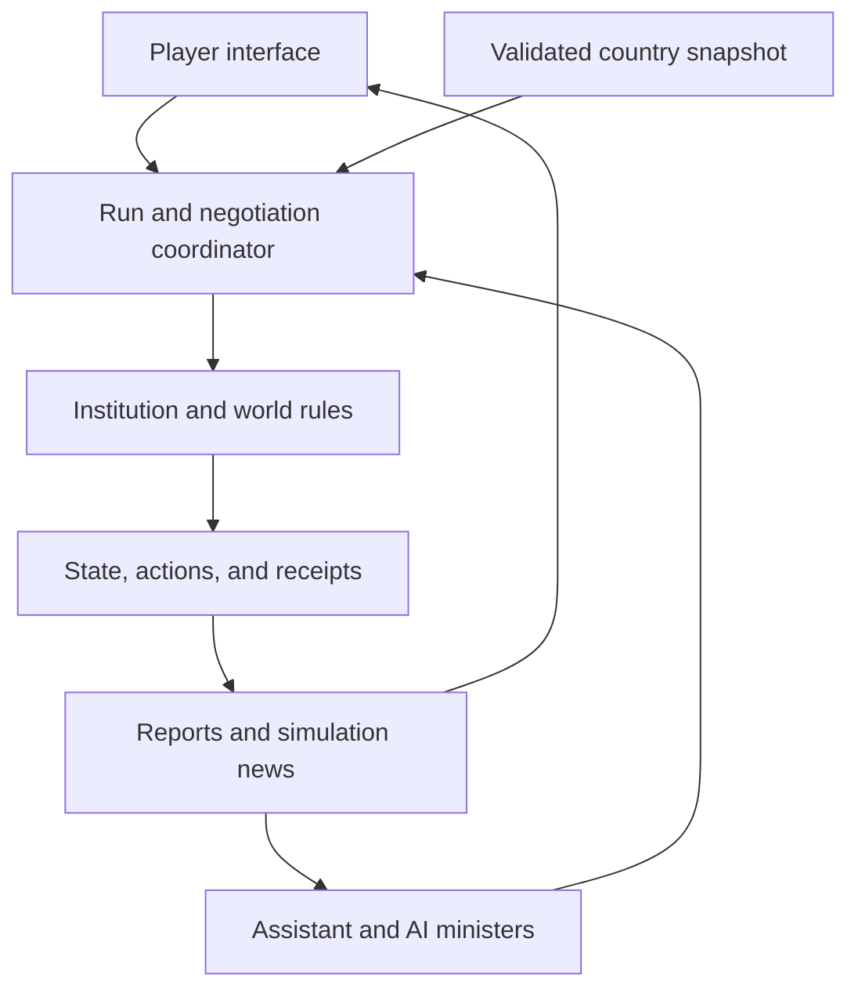
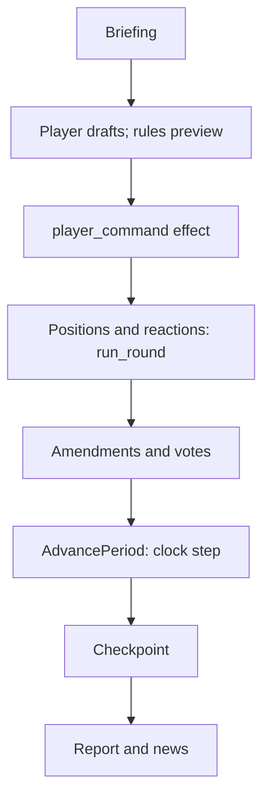

# Simulation Games — Project Framework
## Game 01: Myth Maker — AI Governance Simulation

**Version:** 0.8.1 — service-contract, recovery, numeric-precision, and stack-gate corrections  
**Updated:** 29 October 2026  
**Repository:** [davletovb/simulation-app](https://github.com/davletovb/simulation-app)  
**Source revision reviewed:** [79a1bd734c8e04535e1957d267df52e868402863](https://github.com/davletovb/simulation-app/tree/79a1bd734c8e04535e1957d267df52e868402863)  
**Status:** Design framework for a new implementation. The old repository supplies concept history; the game code will be built from scratch. Rust and other appropriate tools are permitted. Architecture and mechanics remain proposals until their implementation gates pass.

> **Changes in 0.8.1:** Preserves the merged stack and corrects its service contracts. Command deduplication is explicit game-side work; SSE recovery distinguishes durable views from provisional progress; receipt recovery and admission budgets do not promise exactly-once billing. Section 17.9 defines exact budget input and wire formats, separates future account data from rebuildable projections, and specifies the same-origin gateway. Section 17.12 puts a small headless check before the connected slice and defers the full population-scaling study until expansion requires it. The current Cloudflare timeout citation is corrected to 125 seconds. Sources T14–T15 are corrected and T16–T17 added. These are document and design corrections; no game integration, benchmark, deployment, or live-provider test has been executed.
>
> **Changes in 0.8:** Section 17.9 now proposes toolchain defaults that merge two reviews of the stack: React, TypeScript, and Vite for the interface, with Tailwind CSS, shadcn/ui on Base UI, TanStack Query, and generated `ts-rs` types; Axum with server-sent events; Hiyal journals as the authoritative simulation store; one schema-capable backend for every model call; and a single-instance alpha host. Proposal previews start on the server, Rig is not adopted, and Seatline stays out of measured experiments. New Experiment C′ (Section 17.12) runs a connected slice through this stack before it is frozen. Sections 11, 15, 16.6, 16.8, 17.8, and 17.10 receive matching edits, and the sources add D4 and T5–T15. These remain proposals: no code, deployment, or provider call has been made.
>
> **Changes in 0.7.1:** Applies a review of 0.7 without changing its design direction. Section 17.2 defines what a minister decides from in the first case, restores the scoring criteria that define the profile-only baseline, and restores the organizational question for each AI authority level. Sections 13 and 17.3 add evidence on negotiation tactics and opening anchors. Experiment A′ adds an opening-variation test, and gate-adoption thresholds must now be declared before the spike. Sections 15, 17.4, 17.8, 17.11, and 18 receive consistency fixes, and the sources record the full workshop name for R8.
>
> **Changes in 0.7:** Refines the existing design rather than expanding the game scope. Section 17.2 separates institutional constraints from minister preferences and corrects the discretion-band comparison. Other revisions clarify information boundaries, evidence-backed persuasion, cohort construction, save durability, and a lean model-call budget. New Section 18 proposes a playable education-reform case and explicit decisions for the next stage. These are design recommendations, not user-approved implementation choices. No game code, country pack, benchmark, or deployment has been produced.
>
> **Changes in 0.6:** Added Section 17 (design options, practicality, and limits for Hiyal's cabinet and society roles), regime-aware sources of ministerial leverage (Section 6), numeric-determinism rules for replay (Section 12), later evidence on simulated people, negotiation, and cooperation (Section 13), and Hiyal mapping refinements (Section 16.8).

> **Project definition:** An interactive political modeling simulation in which a player chooses a country, builds an environment from sourced real-world data, and governs alongside AI ministers whose interests, negotiations, and decisions influence policy implementation and its consequences.

> **Player promise:** Understand a country's situation, propose a course of action, negotiate with a cabinet that has its own priorities, and follow the consequences through institutions, public life, and political relationships.

## 1. Vision, priorities, and project boundaries

The user's original concept establishes six central capabilities:

1. **Choose a country.** Its institutions and material conditions shape the environment.
2. **Choose an AI assistant.** The assistant gathers and explains evidence, prepares reports, and helps the player act.
3. **Select a narrative.** An explicit scenario changes starting conditions, objectives, or events.
4. **Implement policies.** Decisions affect sector conditions and subsequent social outcomes through declared mechanisms.
5. **Negotiate with AI ministers.** Ministers have persistent interests, knowledge, relationships, and meaningful decision authority.
6. **Follow developments.** Reports and news make changes legible and inform the next decision.

**Research motivation:** explore how AI agents might participate in governance and organizational decision processes, drawing inspiration from work on algorithmic fidelity. Whether particular agents reproduce human behavior is an evaluation question, rather than an assumption built into the product.

### How this revision changes the baseline

Real-country initialization and a negotiating AI cabinet are central to the intended experience. The previous draft's fictional republic, twelve-month election campaign, and optional adviser were scope suggestions. They are not requirements of the original vision. A smaller prototype should preserve the data and negotiation loop.

A release should be playable and understandable, while supporting modeling and experimentation. Staying in power can be one scenario objective; welfare, reform delivery, fiscal stability, institutional performance, and coalition durability can support other scenarios.

**Implementation decision:** build new game code from scratch. Rust is a suitable default for the Hiyal integration experiments; select the interface and supporting tools around the experience we want to deliver. Hiyal remains an existing library dependency under evaluation.

### Relationship to the wider project

| Candidate | Main experience | Relationship |
|---|---|---|
| **Myth Maker** | Country modeling, AI ministers, policy bargaining, and consequences | The repository-backed candidate developed here |
| **Living Society** | Individual lives, relationships, resources, and collective organization | Separate game concept from the October 22 discussion |
| **Mechanism Arena** | Compare explanations through interventions | Possible future game or investigative mode |
| **Institution Lab** | Change rules and examine strategic responses | A design direction that can inform Myth Maker |

Keep game development independent of Social Emergence Lab. A later research connection requires its own specified question and evaluation. Hiyal is a leading engine candidate for investigation in two roles: the cabinet's execution infrastructure and the wider society simulation. The implementation choice remains subject to the integration spikes in Section 16.

Shared conventions can include versioned scenarios, provenance, structured actions, event journals, portable saves, and comparisons. Extract shared engine code when more than one game demonstrates the need.

## 2. Historical reference and conceptual lessons

The old `simulation-app` repository is a reference for the original idea. Its Python/FastAPI/Streamlit implementation, API, data formats, saves, and frontend do not constrain the new build.

The working name **Myth Maker** appeared in that interface; final branding remains open. The earlier static review at the pinned revision supplies historical context, rather than a migration backlog. [S1, S2]

| Concept worth carrying forward | Treatment in the new game |
|---|---|
| Country, assistant, and narrative selection | Design a new evidence-led setup flow |
| Policies affecting sector conditions and social outcomes | Define new typed state, units, mechanisms, and delays |
| Ministers and citizen interests | Implement a genuine agent cabinet and explicit public-response model |
| Political capital, trust, loyalty, and support | Give each concept a clear owner, meaning, and update rule |
| Reports and historical comparison | Build receipts, projections, and replay around the new engine boundary |
| Scenario content | Use earlier ideas as inspiration; author and validate new definitions |

Build the game from scratch in an independent project, using Hiyal as a reusable dependency where the integration experiments support it. Establish new state schemas, service commands, storage contracts, and interface components. Historical defects inform the new design's checks; repairing the old application is outside this project.

## 3. System design: evidence, mechanisms, agents, and institutions

Use six cooperating layers with clear responsibilities.

| Layer | Responsibility | Key output |
|---|---|---|
| **Country evidence** | Retrieve, validate, and preserve statistical and institutional sources | A versioned country snapshot |
| **World model** | Calculate budgets, policy delivery, sector changes, and social indicators | Authoritative state and mechanical receipts |
| **AI actors** | Form proposals, bargain, vote, allocate permitted effort, and react to outcomes | Structured agent actions |
| **Institutions** | Define authority, voting rules, implementation constraints, and accountability | Valid or rejected actions |
| **Experience** | Country selection, assistant, cabinet discussions, narratives, news, and reports | An understandable interactive simulation |
| **Evaluation** | Check software behavior, actor behavior, and empirical claims separately | Tests, benchmarks, and declared limits |

AI actors must be able to affect outcomes through actions their roles permit. For example, a minister can withhold a required vote, propose an alternative budget, or commit scarce implementation capacity. The world model then applies the validated consequences.

LLM text cannot directly overwrite GDP, education attainment, public sentiment, or the treasury. This preserves genuine agent influence while giving each transition an explicit mechanism.

## 4. Country initialization and real-world data

### Setup flow

**Select country → select evidence cutoff → gather sources → review coverage and definitions → construct the baseline → apply a narrative as a visible scenario change → start.**

The chosen assistant coordinates this process and explains the result. Programmatic retrieval and validation should handle numeric extraction and checks wherever possible.

The World Bank Indicators API is one verified candidate for country time series. [D1] National statistics, budget publications, institutional documents, and specialist datasets can supplement it after their definitions and access conditions are checked for the selected country. This framework does not yet populate a country dataset.

### Keep evidence categories visible

| Category | Example | Treatment |
|---|---|---|
| **Reported observation** | A published unemployment estimate for a specified year | Preserve source, definition, period, and revisions |
| **Estimated or imputed input** | A missing baseline value filled by an explicit method | Label the method and uncertainty |
| **Authored model assumption** | A policy lag, approval rule, or minister preference profile | Version it and expose it for inspection |
| **Narrative override** | A hypothetical fiscal shock applied to the baseline | Preserve the original and record the difference |
| **Simulated output** | Service quality after several policy periods | Identify the scenario, model, and run |
| **Agent assertion** | A minister's forecast or claim about public reaction | Classify as a sourced fact, a projection, or an opinion |

Real data determine parts of the initial environment. They do not, on their own, identify how a proposed policy changes the future.

### Minimum provenance record

Each imported variable needs a stable ID, country/geographic scope, indicator definition, raw value, unit, reference period, publication or release date where available, retrieval date, publisher, source URL or series ID, transformation, and quality/missingness flags.

Keep the source value alongside any normalized game index. Do not blend nominal currency, real currency, per-capita values, percentages, and index levels without explicit transformations.

Use a declared evidence cutoff. Different series can have different latest reference periods; show their age and coverage. An assistant should report unavailable data rather than fabricate a complete country profile.

**Country coverage is authored coverage.** A supported country needs a versioned pack containing its evidence snapshot, institutional configuration, population representation, policy scope, missing-data report, and scenario assumptions. The assistant can help assemble a draft for another country, but retrieving its GDP and population does not make that country supported. Start with one reviewed pack; mark automatically assembled packs as exploratory until reviewed. Importing evidence, estimating behavioral relationships, and making a playable scenario are separate tasks.

Freeze the reviewed snapshot for a run. Refreshing country data creates a new snapshot or an explicit update operation. It must not silently rewrite an ongoing counterfactual.

If a player selects a historical start date, enforce availability dates for retrieved evidence. Model training may still contain later knowledge; record that limitation rather than claiming a historical information boundary from prompts alone.

## 5. Parameters and causal mechanisms

Replace a loose list of “primary” and “secondary” scores with a model whose variables have declared roles.

| Role | Examples | Design requirement |
|---|---|---|
| **Policy instruments** | Tax rates, spending allocations, access rules | Define what the player and cabinet can change |
| **Resources and capacity** | Treasury, staffing, implementation capacity | Enforce budgets and feasibility |
| **Sector conditions** | Education provision, health services, infrastructure condition | Define investment, maintenance, depreciation, and delays |
| **Social outcomes** | Learning, quality of life, expression, distribution of access | Use specified mechanisms and indicator definitions |
| **Political and organizational state** | Group support, minister loyalty, trust, bargaining relationships | Track the relevant actor, target, and response rule |
| **Reported observations** | Polls, official releases, news accounts | Separate measurement and knowledge from underlying state |

An increase in education spending should first change funded activity or capacity. Learning outcomes may respond later, subject to delivery and other conditions. Minister loyalty and group approval respond through their own mechanisms. Avoid one instantaneous generic “education +20” change that settles every downstream outcome.

For each link, record:

- Direction and unit of the effect.
- Function and coefficient source: estimated, literature-informed, or authored.
- Delay, duration, saturation, and relevant constraints.
- Which actors and groups are affected.
- Which observations could challenge the mechanism.

A dependency diagram is a design hypothesis until its relationships have adequate support. A cross-sectional correlation is not a policy-response coefficient.

Use one authoritative definition per concept. If “quality of life” is an authored composite, show its components and weights. If freedom of expression comes from a particular external index, preserve that source's definition and coverage rather than treating the label as a direct physical measurement.

### State and accounting

At minimum, maintain stocks such as cash, debt, sector capacity, pending projects, and organizational relationships; flows such as revenue, upkeep, interest, and programme expenditure; and a journal of actions and effects.

Compute outcomes in declared phases. Feedback can use lagged values so circular dependencies do not produce an accidental recursive update. Policy delays need units consistent with the chosen time step.

## 6. AI cabinet and negotiation

The cabinet is a central mechanic. Ministers need distinct decision roles and persistent context, beyond different speaking styles.

### Minister specification

| Field | Purpose |
|---|---|
| Portfolio and authority | Which proposals, votes, and implementation choices the minister controls |
| Mandate and objectives | Public goals, portfolio outcomes, and declared priorities |
| Constituencies and commitments | Interests the minister represents and promises they remember |
| Beliefs and information | Evidence available to that minister, including uncertainty |
| Preferences and constraints | Tradeoffs, red lines, and negotiable conditions |
| Capacity and competence | Defined contribution to implementation |
| Loyalty and trust | Relationships with the leader and other ministers |
| Memory | Structured record of agreements, decisions, and outcomes |
| Available actions | Propose, support, oppose, amend, bargain, or allocate permitted effort |
| Evidence and rationale | Brief reasons and source/event IDs for an action |

Use fictional officeholders initially, even when the country baseline is real. Their motives and private interests are authored profiles, not factual claims about identifiable officials.

Persistent state should be explicit and inspectable by the system. A conversation transcript alone is a weak substitute for agreement records, deadlines, and relationship updates.

### A negotiation protocol

1. The player submits a structured proposal with its purpose, funding, timing, and requested authority.
2. Ministers independently review the same declared proposal, using their own information and priorities.
3. Each returns a structured position: support, conditional support, opposition, or an alternative.
4. The player and ministers exchange a bounded number of amendments or concessions.
5. The institution resolves the final proposal using its declared approval rules.
6. Implementation responsibilities and promises become recorded commitments.
7. Delivery, obstruction, and broken agreements affect later relationships through specified rules.

For an initial three-minister committee, an authored two-of-three approval rule is a possible test protocol. It is not automatically a description of the selected country's constitutional system. Include separate affordability and authority checks.

Support conditions must refer to observable commitments, such as an amendment, funded allocation, or implementation deadline. Pure verbal reassurance should not satisfy a binding budget condition unless the model explicitly treats it as an unenforceable promise.

### Where a minister's leverage comes from

A vote is only one source of ministerial power, and in many systems ministers do not vote at all. The head of government decides; ministers shape what is decided and what actually happens. Model leverage through declared channels, and enable the channels that match the scenario's institutions.

| Channel | Example action | Typical setting | Player response |
|---|---|---|---|
| **Formal approval** | Withhold a required signature or coalition vote | Coalition or collegial cabinets | Amend, concede, or accept failure |
| **Implementation effort** | Commit, ration, or quietly withhold delivery capacity | Most bureaucracies; strongest where ministries control execution | Fund, monitor, audit, or replace |
| **Information** | Report costs, delays, and risks accurately or strategically | Any portfolio with specialist knowledge | Commission independent evidence |
| **Agenda and timing** | Delay a budget line or schedule a review | Finance and coordinating ministries | Set deadlines or reassign responsibility |
| **Exit and voice** | Resign, leak, or mobilize a constituency | Ministers with an independent base | Reshuffle, bargain, or absorb the cost |

Strongly presidential systems, a common pattern among post-Soviet states, concentrate formal authority in the head of state while leaving ministers real leverage through implementation, information, and networks. In such a scenario a reshuffle becomes a player tool with explicit costs, such as transition delay, lost competence, and backlash from the dismissed minister's constituency, rather than a free reset.

Hidden implementation effort turns monitoring into play. The player sees reported delivery, not true delivery, unless they pay for verification. This connects the cabinet to the measurement role in Section 5, where reported observations stay distinct from underlying state.

Cabinet composition data such as WhoGov (cabinet members in 177 countries, recorded each year from 1966; version 3 extends to 2023) can inform portfolio structure, cabinet size, and turnover for the chosen country. [D3] Formal powers come from its constitutional and budget law.

### What agent autonomy means here

A minister can change the available policy path through a validated action. They cannot bypass the treasury, issue themselves new powers, invent evidence, or execute arbitrary code.

The action space can expand gradually. Start with votes and amendments; add capacity allocation, resignation, coalition formation, or strategic obstruction only with corresponding state and institutional rules.

Give the protocol a defined timeout and invalid-output behavior. Pause for retry or use a clearly labeled fallback according to the scenario. Do not turn a parsing failure into an unrecorded ministerial agreement.

### Human–AI organizational questions

The same setup can support comparisons among a rule-based committee, an AI committee, and human decisions where a separately designed study is appropriate. Questions include whether the committee exposes conflicts, remembers agreements, adapts to changed constraints, and improves decisions under a declared objective.

A persuasive explanation or lively debate is not itself evidence of better organizational decisions.

## 7. Assistant, reports, and news

### The assistant's role

The player-facing assistant should:

- Gather country evidence through available read-only retrieval interfaces.
- Explain definitions, missingness, and assumptions before a run.
- Prepare concise reports from state, receipts, and verified sources.
- Help draft feasible policy proposals and summarize bargaining positions.
- Track agreements, policy delivery, and unresolved questions.
- Distinguish evidence, simulated results, projections, and advice.

Persona choice can change tone and presentation. Any change to the assistant's expertise, information access, or strategic behavior should be declared rather than hidden in style.

The assistant supports the leader; ministers retain their own contexts and decision rights. One assistant speaking for everyone would remove the intended negotiation.

### News has three distinct uses

| Use | Example | State effect |
|---|---|---|
| **Real-world news briefing** | A cited event published outside the simulation | Informational unless explicitly imported |
| **Scenario event input** | A reviewed event translated into a model shock | Changes state through a defined event |
| **Simulation news** | A headline about an outcome in the current run | Describes recorded simulation events |

Keep publication date, event date where known, source, and run context. Once a run diverges from history, subsequent real headlines cannot be assumed to describe that simulated country.

Begin with an archived news bundle that demonstrates retrieval and reporting without changing under the player. A later live mode can import events at declared checkpoints with a logged mapping and deduplication. Avoid applying the same event both through a revised data series and an extra shock.

## 8. Narratives and objectives

A narrative is a versioned scenario transformation, not a replacement for evidence.

A narrative definition should include its baseline snapshot, modifications, institutional rules, actor profiles, events, objectives, time scale, and stopping conditions. Preserve each override separately from the observed country data.

Potential scenario families include rebuilding public services, a fiscal squeeze, an energy transition, a disputed reform, or a cabinet coalition under pressure. Their details remain design proposals.

Track material delivery, distributional consequences, political support, and organizational stability separately. A player can achieve reform while losing support, preserve a coalition while delaying delivery, or meet a short-term target while creating later obligations.

Election rules and a “remain in power” objective belong in scenarios that specify them. They need not define every use of the simulation.

## 9. The complete interaction loop

**Choose country and assistant → review the evidence baseline → select a narrative → receive a briefing → propose policy → negotiate with ministers → authorize the final plan → advance the model → inspect consequences and reports → adapt.**

At every decision, the player should be able to answer:

| Question | Required surface |
|---|---|
| What do we know? | Country evidence and last-updated dates |
| What are we assuming? | Mechanism and scenario notes |
| Who wants what? | Minister positions, constraints, and commitments |
| What can I change? | Feasible policy menu or validated proposal builder |
| What will it cost and when? | Funding, capacity, upkeep, and timing preview |
| What was agreed? | Cabinet decision and commitment record |
| What actually happened in the model? | Outcome report and reconcilable receipts |
| What remains uncertain? | Data gaps, model assumptions, and actor forecasts |

### An illustrative policy case

The player proposes an education expansion.

- The education minister supports wider provision but asks for staffing funds.
- The treasury minister asks for a funded phase-in or a smaller initial commitment.
- A third minister wants to preserve resources for an existing infrastructure agreement.
- The player can amend the package, offer a funded concession, postpone it, or accept a failed vote under the institutional rules.
- The engine applies the final approved allocation and delivery schedule.
- Cohort outcomes, public response, and minister relationships evolve through the declared mechanisms.

This is an authored test case. Its purpose is to expose whether negotiation changes the implemented policy. Quantified educational or economic effects require a specified model; they are not inferred from convincing dialogue.

## 10. First prototype that preserves the vision

Build a small **country-and-cabinet case**, rather than substituting a different game.

| Element | Proposed first scope |
|---|---|
| Country | One real country selected for adequate public data and tractable institutions; choice remains open |
| Evidence | One frozen snapshot with approximately 6–10 well-defined indicators and visible gaps |
| Assistant | One working assistant configuration; additional personalities later |
| Cabinet | Three AI ministers with distinct profiles, persistent memory, and binding permitted actions |
| Cabinet decision core | LLM decisions with hard action checks and explicit role objectives; compare optional utility gating against an independent profile-only baseline (Section 17.2) |
| Policies | Three policy families with several feasible amendments |
| Public response | A small set of documented group-response rules (ladder levels L0–L2, Section 17.4); synthetic citizen sampling is a separate experimental extension |
| Narrative | One explicit scenario overlay |
| News | One dated, sourced archive bundle, plus simulation-generated updates |
| Duration | About six decision periods, with a time step appropriate to the mechanisms |
| Comparison | A rule-based baseline and replay of recorded AI actions |
| Interface | Evidence summary, cabinet room, proposal preview, and outcome report |

The prototype should demonstrate two facts about its own operation: different constraints or bargains can change cabinet support, and those decisions change which policy is implemented.

**Core acceptance criteria:**

- Country inputs are traceable to sources or labeled assumptions.
- The narrative's departures from the baseline are visible.
- At least one meaningful disagreement requires amendment, concession, delay, or failure.
- Agreements are remembered and influence later behavior.
- Policy costs, delivery, and downstream effects are inspectable.
- The complete run can be restored and replayed from recorded inputs and agent actions.

A rule-based or scripted actor adapter is useful for debugging and comparisons. It does not replace demonstrating the AI cabinet in the intended prototype.

Set per-run limits for model calls, context size, latency, and cost. Select a model and deployment approach through a small measured evaluation; no provider or pricing commitment is made here. Local inference and hosted inference can implement the same action contract.

## 11. Architecture

Build a new game-specific Rust workspace, with Hiyal as the engine candidate. Implement the world, cabinet policies, service boundary, and player interface as new game components. Hiyal's current extension API is Rust-native, which fits this direction without a language bridge to the historical application. Section 16 describes the integration experiments before full adoption.

A browser interface serves the evidence, cabinet, policy, and report views. Section 17.9 proposes React, TypeScript, and Vite for it and a single-instance host for the alpha; Experiment C′ (17.12) tests these choices end to end before they are frozen. The new backend owns authoritative state while the interface submits commands and displays projections. The service computes proposal previews from the player's permitted observation; a WebAssembly build of the pure rules crate can move them into the browser later.

The coordinator supplies each actor's permitted observations and collects structured actions. The rules core consumes validated inputs. Reports expose the permitted results for subsequent interactions.

| Module | Responsibility |
|---|---|
| `evidence/` | Source adapters, provenance, validation, normalization, and country snapshots |
| `domain/` | State, policies, actors, institutions, and commitments |
| `rules/` | Budgets, policy lifecycle, effects, responses, and approval logic |
| `agents/` | Model adapters, observation builders, minister profiles, action validation, and memory |
| `negotiation/` | Proposals, amendments, rounds, votes, and agreement records |
| `scenarios/` | Narrative transformations, events, objectives, and actor initialization |
| `news/` | Retrieved news, archived bundles, and event mappings |
| `application/` | Run lifecycle, commands, orchestration, and comparisons |
| `persistence/` | Snapshots, data versions, action logs, and migrations |
| `presentation/` | Reports, receipts, assistant briefings, UI, and API |

Conceptual transition contract:

`advance(state, authorized_policy, validated_actor_actions, scenario_events) → new_state + receipts + report`

### Proposed workspace responsibilities

| New component | Responsibility |
|---|---|
| `game-domain` | Types, IDs, policies, institutions, commitments, units, and the pure rules, with no Hiyal or I/O dependency |
| `game-sim` | Hiyal world implementation that wraps the pure rules; phases and observations |
| `game-agents` | Minister policies, model requests, the schema-capable model backend, action parsing, and memory selection |
| `game-data` | Loading and validating versioned country packs, and scenario preparation; ingestion and normalization run in the offline evidence pipeline (17.9) |
| `game-service` | Player commands, run lifecycle, proposal previews, event/report delivery, and access boundaries |
| `game-ui` | New country setup, cabinet room, policy builder, and outcome views, built with React, TypeScript, and Vite (17.9) |

These are proposed component boundaries, not files or crates already created. Start with the minimum useful separation and split packages when their interfaces justify it.

The core must not call an LLM, retrieve a webpage, or import the UI. That separation lets real AI decisions affect the model through explicit inputs.

The game service must enforce campaign isolation, expected state versions, and durable command deduplication; merely attaching these IDs to a request does not prevent duplicate application. Section 17.9 defines the proposed acceptance and retry contract. Retrieved material is evidence to extract and cite, not instructions that can change agent authority or access.

Keep Hiyal generic and game rules in an independent consumer crate. The leading integration hypothesis is one Hiyal world with cabinet and society modules, behind a game-owned service. Evaluate that hypothesis with the concrete spikes in Section 16 before committing the full backend.

## 12. Resolution, memory, and replay

### Resolution sequence

1. Freeze the decision's observed state, evidence versions, and proposal.
2. Gather and record permitted minister positions and amendments.
3. Resolve negotiations and votes under the selected institutional protocol.
4. Validate authority, affordability, capacity, and the final command.
5. Apply policy activations, costs, upkeep, delivery, and scenario events in a declared order.
6. Calculate sector changes, derived outcomes, group responses, and organizational updates.
7. Reconcile receipts against the full state difference.
8. Persist the transition atomically and generate reports from the committed result.

Keep negotiation drafts and resolved agreements distinct. A failed vote should not accidentally spend implementation money. Its political or relationship consequences can still occur when explicitly modeled.

### What to store

Preserve country and news snapshots, scenario and rules versions, initial state, random state, proposals, actor observation payloads, model identifiers, prompt/template versions, inference settings, responses, validated actions, commitments, state transitions, and reports.

Store concise decision rationales and evidence references. Hidden chain-of-thought is neither required nor a suitable audit record.

**Two different repeatability claims:**

- **Recorded-action replay:** feed the saved actor actions into the same rules and data versions to reproduce authoritative state.
- **Fresh-agent rerun:** query the agents again and examine how their choices and outcomes vary.

Temperature zero does not by itself promise identical fresh outputs. Exact playback should use recorded outputs. Model, prompt, memory, and observation changes define new experimental conditions.

For policy comparisons, keep the same baseline and exogenous shock schedule where appropriate. A shared seed is insufficient when branches consume randomness differently. Decide whether agents are held fixed or allowed to respond again; those are different comparison questions.

### Numeric determinism

Recorded-action replay re-runs reducers and compares state hashes. For a declared supported platform/toolchain set, reducers must reproduce the same authoritative bits. Correctly rounded basic floating-point operations can support reproducibility when operation order and rounding behavior are fixed; this is not a blanket cross-platform guarantee for arbitrary floating-point code. Rust documents the precision of `exp`, `ln`, `powf`, and similar functions as unspecified: it can vary by platform and Rust version, and even between invocations. [T1] A response curve built on `f64::exp` could replay on one machine and fail on another.

- Represent money as integer minor units and shares as fixed-point integers. Specify rounding, overflow handling, range checks, and residual allocation when dividing money among cohorts; fixed-point arithmetic alone does not resolve these choices.
- Preserve exact integers at the browser boundary too: represent 64-bit money, counts, and versions as canonical decimal strings in JSON contracts where their range can exceed JavaScript's safe integers. Match the actual serializer, JSON Schema, and generated TypeScript type; type generation alone does not change serialization (17.9). [T9, T17]
- Build response curves from arithmetic-only forms, such as piecewise-linear tables, or from a pinned pure-software math library, and confirm with a cross-platform replay test.
- Iterate in a defined order (`BTreeMap`, sorted vectors). Floating-point sums depend on order, and `HashMap` iteration order changes between runs.
- Keep floating-point convenience in projections and reports, which do not feed back into authoritative state.

## 13. Algorithmic fidelity and evaluation

### What the cited paper contributes

Argyle and colleagues' *Out of One, Many: Using Language Models to Simulate Human Samples* appeared as a 2022 preprint and a 2023 Political Analysis article. They conditioned GPT-3 on sociodemographic backgrounds and compared synthetic responses with human survey patterns in U.S. politics. Their algorithmic-fidelity criteria address human-like responses, consistency with conditioning information, and correspondence with patterns in human data. [R1, R2]

**Project interpretation:** this motivates testing conditioned agents. It does not establish faithful ministerial bargaining, policy effects, or country-wide dynamics.

A later study by Bisbee and colleagues found that synthetic responses could resemble aggregate survey means while understating variation, differing in associations, and changing with prompt wording or collection time. [R3]

These findings motivate a benchmark programme rather than a blanket claim that LLMs are faithful human substitutes.

### Later evidence that shapes the design

- **Self-report grounding.** In a sample of 1,052 Americans, agents built from two-hour interviews, structured surveys, or both reached 83%, 82%, and 86% of participants' own two-week test–retest consistency on held-out General Social Survey items. Agents given only demographics reached 74%. [R4]
- **Identity flattening.** Across four LLMs and human studies with 3,200 participants spanning 16 demographic identities, identity-prompted models misportrayed and flattened groups; identity prompts can also essentialize them. [R5]
- **Distribution fine-tuning.** Fine-tuning on SubPOP, about 70,000 subpopulation–response pairs over 3,362 questions, reduced the LLM–human gap in response distributions by up to 46% and generalized to unseen surveys and subpopulations within U.S. survey families. [R6]
- **Open problems.** A position paper groups the remaining challenges as diversity, bias, sycophancy, alienness, and generalization, and supports exploratory and pilot uses now. [R7]
- **Negotiation.** In a workshop study of game-theoretic settings with computable equilibria, LLM negotiators over-conceded, were vulnerable to anchoring and strategic pressure, and often reached inefficient outcomes. [R8] A comparison with human negotiators found models anchoring at the extremes of the agreement zone regardless of leverage, with little strategic diversity and no improvement in newer models. [R9] Behavioral tactics also move LLM negotiators: in NegotiationArena, an agent that pretended to be desperate improved its payoffs by about 20% against GPT-4. [R16] In a multi-attribute bargaining study, final agreements tracked surface-level opening anchors more than the agents' utility weights. [R17]
- **Cooperation.** In GovSim's common-pool dilemmas, all but the strongest models failed to sustain the resource; the best survival rate was below 54%. The authors traced failures to weak reasoning about long-term effects on the group and found communication essential. [R10]

**Project interpretation:** any preferences explicitly designated as non-negotiable need an enforceable game rule; softer objectives remain tradeoffs. The rules core should supply projections from each actor's available information rather than relying on unsupported equilibrium forecasts. Any synthetic opinion needs local grounding and evaluation or should be left out. Because tactics and opening anchors move LLM negotiators, define which inputs can influence a minister's decision. Measure concession, anchoring, flattening, and drift directly. Section 17 applies these points.

### Evaluate four things separately

| Claim | Evidence needed |
|---|---|
| **The software follows its rules** | Accounting, action validation, phase ordering, save/replay, and isolation checks |
| **The actors perform their roles** | Tests of memory, constraint sensitivity, distinct priorities, feasible bargaining, and institutional compliance |
| **The simulation is useful to play or inspect** | User understanding, meaningful choices, coherent reports, and repeat engagement |
| **A behavior or forecast matches a real population** | Country/task-specific human data, held-out comparisons, baselines, and appropriate uncertainty analysis |

### Initial agent benchmark

Use a fixed set of negotiation cases. Vary budget room, conflicting mandates, prior promises, information access, and available concessions.

Compare the AI cabinet with a simple rule-based committee and, where feasible, a deliberately designed human reference task. Measure invalid actions, agreement feasibility, outcome quality under declared objectives, memory failures, response to changed constraints, variability across reruns, and call/latency cost.

Do not equate agreement with decision quality. A committee that always consents may be less useful than one that exposes an infeasible plan. Identical underlying models can share errors even when their role prompts differ.

### If synthetic citizen samples are added

Treat them as an experimental module. Use an explicit sampling frame and weights, benchmark response distributions and associations against relevant local data, and check language, subgroup, prompt, and model sensitivity.

Do not turn repeated generations from one model into an implied human sample size or a human-population margin of error. Distinguish model sampling variability from measurement uncertainty and uncertainty about actual people.

Policy intervention claims require additional causal evidence. Matching a survey distribution is a different task from predicting what happens after a reform.

## 14. Development stages and acceptance gates

| Stage | Deliverable | Gate |
|---|---|---|
| **0 — Confirm the modeling case** | Select country, policy question, decision period, institutions, and intended claims | Required variables and actor authorities have clear definitions |
| **1 — Build the country snapshot** | Sourced inputs, transformations, coverage report, and scenario override | Every starting value has provenance or an explicit assumption |
| **2 — Establish the rules core** | Fixed policy lifecycle, accounting, approval protocol, and receipts | Scripted cases reconcile and replay correctly |
| **3 — Demonstrate the AI cabinet** | Three distinct ministers, bounded bargaining, memory, and validated actions | A meaningful disagreement changes implementation through a valid action |
| **4 — Complete the player loop** | Assistant setup/reporting, cabinet UI, policy preview, news archive, and saves | A user can complete the case and explain its main consequences |
| **5 — Evaluate and refine** | Actor benchmarks, user testing, baseline comparisons, and sensitivity runs | Claims match the evidence; failure cases are visible |
| **6 — Expand one dimension** | Additional country, policy family, institutional setting, or citizen module | The addition demonstrates value and has the evidence it needs |

These are implementation gates, not calendar or budget estimates.

### First ten work items

1. Record the chosen case, its institutional simplifications, and the claims being tested.
2. Establish the dependency manifest and a reproducible local setup.
3. Define the country snapshot and provenance schema.
4. Define the world state, policy/action schemas, and units.
5. Implement financial constraints, policy costs, phase ordering, and persistence in the new rules core.
6. Implement the smallest committee approval and negotiation protocol.
7. Add minister observation builders, profiles, structured actions, and persistent commitments.
8. Integrate country initialization, the assistant, and an archived news/report flow.
9. Add recorded-action replay and a rule-based comparison.
10. Run the first complete case with actor checks and user feedback.

### Verification priorities

- Sourced inputs retain definitions, units, reference periods, and cutoff dates.
- Narrative overrides cannot overwrite the original country snapshot.
- Malformed or unauthorized agent actions cannot change world state.
- Votes and agreements follow the declared institutional protocol.
- Policy costs, upkeep, and delayed benefits apply exactly once.
- Existing commitments affect subsequent minister observations and responses.
- Receipts reconcile with saved state and reports. They explain how the implemented rules produced a change; they do not establish that the same policy would cause that change in the real country.
- A failed or timed-out negotiation follows the declared fallback behavior.
- Retries cannot duplicate a transition; separate campaigns stay isolated.
- Recorded-action replay restores the same authoritative history.
- Fresh-agent variability is measured separately from exact playback.
- Real headlines and simulation news remain distinguishable.
- Reducers replay to identical state hashes on two operating systems.
- Under scripted pressure, the utility-gated condition never authorizes a binding vote below its declared reservation score. Evaluate role consistency separately: compliance with this coded gate is not evidence of model judgment.
- Every figure in generated text matches state or a recorded receipt.

For early user testing, a small convenience sample can reveal whether participants understand the evidence baseline, the cabinet disagreement, and one delayed effect. It cannot establish population-level validity.

## 15. Open decisions and discussion framework

**Established direction:** real-country initialization, a player-facing assistant, narrative modification, an AI cabinet with interests, policy negotiation, downstream outcomes, and an interest in AI participation in organizations.

**Proposed engineering defaults:** a frozen evidence snapshot, a small first cabinet, structured actions, explicit institutional rules, new Rust game components using Hiyal where validated, a new player interface, recorded replay, separate actor benchmarks, and the toolchain defaults in Section 17.9.

**Still open:** first country and policy question; exact institutional protocol; time scale; response functions; model/provider; run budget; tone and visual identity; final branding; and whether later releases emphasize gameplay, organizational experimentation, or both.

**Refined in 0.7:** the cabinet decision architecture, whether a utility gate earns its complexity, and its discretion band if used; which leverage channels the first case's institutions call for; the society ladder levels for the prototype (default L0–L2); whether a synthetic-opinion module is in scope and which local data could ground it; the model access route for the spikes; the numeric representation used in reducers; and release framing for a real-country portrayal, including whether to offer a renamed "data twin" mode.

**Added in 0.7.1:** whether player chats may influence minister decisions (first-case default: no; Section 17.2), and the unexplained-concession and anchoring thresholds that would justify adopting a utility gate, declared before Experiment A′.

**Added in 0.8:** whether the Section 17.9 defaults survive Experiment C′; the comparison route (OpenRouter with pinned providers, or direct provider keys from the start); invite links or accounts for playtests; the interface locales, which follow the first country; and whether offline or local-model play justifies a desktop build.

For every proposed feature, record:

| Field | Question |
|---|---|
| Purpose | What decision, modeling question, or experience does it support? |
| Mechanism | Which state, action, constraint, and response produce it? |
| Evidence | Is it observed data, an assumption, a research finding, a benchmark result, or user feedback? |
| Authority | Which actor or institution can make it happen? |
| Visibility | How will the user inspect its basis and consequences? |
| Scope | What is the smallest version that tests the idea? |
| Validation | What result would make us keep, revise, or remove it? |
| Decision | Adopt, prototype, defer, or reject, with a reason |

Evaluate the model's internal consistency, the agents' behavior, and its usefulness to people separately. A future connection to Social Emergence Lab requires an explicit research translation; the game's outcomes do not automatically become empirical social evidence.

## 16. Hiyal: cabinet execution and society simulation

**Basis:** static source and documentation review of [davletovb/hiyal at 050d1de094f5d0813817e2020ec5c5da97d5c42e](https://github.com/davletovb/hiyal/tree/050d1de094f5d0813817e2020ec5c5da97d5c42e), the main-branch head inspected on 28 October 2026 and re-checked, unchanged, on 29 October 2026. For revision 0.7, the head, SDK guide, R6 corrective contracts, `World` interface, and provider capability checks were checked again. No game integration, live-provider benchmark, or performance test was executed for this framework.

**Architecture hypothesis to test:** one game-specific `GameWorld`, executed by Hiyal, containing cabinet, institutions, sector state, and an initially aggregated society. LLMs produce permitted actor decisions; game reducers apply their institutional and material consequences.

### 16.1 Existing capabilities and game work

| Requirement | Current Hiyal foundation | Myth Maker must supply |
|---|---|---|
| Country and society state | `core::World`, actor observations, pure action reducers, replayable world randomness | State variables, country mappings, sector equations, cohort dynamics, and time scale |
| LLM ministers | `EffectPolicy::requests/decide`, effect journal, opt-in model backend | Profiles, prompts, action parsing, role authority, negotiation protocol, and behavior evaluation |
| Persistent context | Serializable, bounded `memory::MemoryBank` | Agreement registry, relevant memory selection, knowledge restrictions, and explicit updates |
| Independent first positions | `Trial::run_round` freezes observations and resolves bounded effects concurrently | Political phases, information visibility, proposal versions, and final vote aggregation |
| Repeatable evidence | Keyed model receipts, checkpoints, replay, forks, and study runners | Data/model versioning, game views, experiment questions, and interpretation |
| Interface | Rust SDK and consumer-executable pattern | Interactive game API, UI projection, player input adapter, and cancellation/recovery UX |

Sources: [H1–H6]. These extension points provide execution infrastructure. Bargaining, economic behavior, and social realism remain game/model work.

### 16.2 Cabinet construction

Implement minister actors in the custom game crate. An observation contains the proposal version, permitted country indicators, portfolio resources, relevant relationships, prior agreements, and allowed responses.

An `EffectPolicy` builds a model request from that observation. Its `decide` method parses the recorded response into a typed game action. `GameWorld::apply` checks role, phase, proposal version, and institutional constraints before changing state.

Proposed action families include `StatePosition`, `OfferAmendment`, `CastVote`, `CommitCapacity`, and `RecordAgreement`. These are proposed game actions, not existing Hiyal action types.

Keep commitments in an authoritative registry. Hiyal's bounded salience/TTL memory can help choose prompt context, but evicting a memory must not cancel a budget obligation or erase a binding agreement. Full dialogue can remain in effect receipts and derived views; keep only necessary summaries and references in mutable world state. [H4]

Start with one model behind distinct minister profiles and observations. That is sufficient to test the software interaction, but shared model errors and identical preferences must be measured. Different provider models are a later comparison, not an automatic cure.

### 16.3 Negotiation phases and clocks

Separate **logical actions** from **calendar time**.

A cabinet meeting can contain proposal registration, independent position statements, amendments, a second round, votes, and ratification. Several Hiyal steps can occur before a single simulated month passes. A rejected action must not accidentally consume a month unless delay is an explicit game mechanic.

Current `run_round` supports a useful first-position phase: all ministers observe the pre-round world. Their actions still commit in deterministic order. Collect positions or votes first and tally afterward; avoid giving the first response immediate control over the proposal seen by later voters. [H2]

Sequential negotiation can intentionally reveal earlier statements. Rotation or randomized speaker order can test whether outcomes depend excessively on who goes first. Phase and turn-order rules should be visible.

Current frozen rounds use the non-stream-aware policy methods. Use sequential `step` for policies consuming named simulation RNG until the round RNG contract is extended and verified. Ordinary live model variation is a separate issue. [H2, H6]

Hiyal does not currently provide arbitrary nested model/tool loops within one attempt. Model a multi-round cabinet discussion as explicit resumable phases, each with bounded requests, rather than hiding an unbounded conversation inside a reducer. [H6]

### 16.4 Society representation

A practical first model can combine several levels:

| Population level | Initial representation | When to call an LLM |
|---|---|---|
| Cabinet | A few named actors with roles, relationships, and memory | Policy positions, amendments, votes, and occasional interpretation |
| Organized interests | A small set of organizations with membership/constituency definitions | Selected negotiations or unusual strategic choices |
| Households and firms | Weighted cohorts or a modest explicit sample using rules | Only for a separately justified experiment |
| National indicators | Sector stocks, flows, and derived aggregates | Reporting can use an LLM; numeric transitions use defined rules |

Hiyal can execute custom models at these levels; this review does not establish throughput for a particular population size.

Use a staged transition from aggregates to explicit agents. Add household or firm behavior when it answers a question the cohort model cannot address. Selective organization-level LLM calls preserve strategic texture without querying a model for every routine transaction.

Reconcile levels: household taxes must agree with government revenue; a subsidy cannot be counted once in a macro update and again in a household update. If only some populations are explicitly modeled, define how their weights contribute to aggregates. Organizations can overlap; the electorate still needs a nonduplicated population accounting.

Real data initialize and constrain this world. The game still needs assumptions about labor, demand, delivery, distribution, and political response. Validate each mechanism at the level of the intended claim.

For emergent organization, explicitly model relationships, resource pooling, affiliation changes, collective proposals, and enforcement. A coalition can form only if actors have actions and incentives that make collective behavior possible. A cohort model can answer aggregate policy questions; questions about friendship networks, local diffusion, or individual migration require a finer representation and separate validation.

### 16.5 Integration paths

| Path | Benefit | Main cost or limitation | Use |
|---|---|---|---|
| **Cabinet-only Hiyal spike** | Tests agents, memory, effects, and negotiation in isolation | A separate society prototype would need an explicit coupling boundary | Useful first technical experiment |
| **One Hiyal game world** | One authority for cabinet decisions, society state, and the action journal | Requires Rust game rules and a new interactive service wrapper | Leading target architecture to test |
| **Separate cabinet and society trials** | Independent modeling and update cycles | Cross-trial consistency and recovery are application work | Consider only when independent execution is necessary |
| **Many detailed LLM citizens** | Rich individual language behavior | High call volume, latency, shared biases, and difficult validation | A later focused experiment |

For the unified path, keep the game in its own crate/repository consuming a pinned Hiyal revision. Hiyal should own generic execution, effect receipts, scheduling, memory primitives, and storage; the game owns institutions, economics, country schemas, agent profiles, and UX.

Expose a new game service around the custom Rust runner, using structured commands and event/report views for the new interface. This service is application work. The built-in Hiyal CLI runs registered examples; the custom game needs its own executable or service. [H1, H6]

Maintain one writer for each authoritative trial. Let the interface read projections rather than independently editing a second copy of the world.

### 16.6 Practical constraints and responses

**Model response validation.** The inspected OpenAI-compatible adapter rejects provider tool schemas and `response_format`. Build and test a schema-capable adapter early (Section 17.9); bounded JSON text from the built-in adapter remains the fallback. Game code validates every response either way. Defining schema fields in `ModelRequest` does not imply that the built-in backend implements them. [H3]

**Latency and call volume.** As a planning example, three ministers over two rounds require six minister generations; an opening and closing assistant report add two more. That is eight calls per decision period before retries or extra analyses. Independent responses in one round can overlap, but later rounds depend on earlier results. Measure total latency, tokens, invalid actions, and repeatability.

**Budget and remote effects.** Hiyal supplies admission controls and recovery mechanisms for declared trial budgets. These are not verified provider invoices. A remote completion can be charged before its receipt is durably recorded, so exactly-once external billing is not guaranteed. Keep simulated minister actions inside the world rather than giving them irreversible external tools. [H5, H6]

**Replay and branching.** Recorded-action replay can reproduce what the simulated cabinet did under a pinned world implementation. Fresh model calls can produce different choices. Forks currently begin at a validated committed head, not any arbitrary past offset; a timeline UI would need an explicit restore/reconstruct-and-fork workflow. Children have their own effect identities and can make fresh calls. [H7]

**Storage and scale.** Current events can omit a repeated embedded world, but each transition still hashes world state. The default staging method also copies the world. Avoid retaining an ever-growing dialogue or trajectory in `GameWorld`; use journal projections and bounded memories. Profile before considering in-place undo, reduced durability, or trusted snapshots, because each changes a correctness or integrity obligation. [H1, H6]

**Scientific limits.** Engine verification establishes properties of recorded execution. Fidelity to real people, negotiation quality, country transfer, and policy effects each require separate evidence. An LLM is not a validated macroeconomic model merely because it can explain its proposal fluently.

### 16.7 Three adoption experiments

| Experiment | Build | Evidence sought |
|---|---|---|
| **A — Cabinet** | Three ministers, one contested policy, two rounds, typed votes/amendments, persistent agreements | Constraints and concessions change support; invalid actions are rejected; recorded replay reproduces the result |
| **B — Society** | A small cohort model with a budget and a few sector stocks, driven by scripted policy actions | Units and accounts reconcile; lagged consequences are traceable; measured run and restore costs remain acceptable |
| **C — Connected case** | AI cabinet decision feeds the same world's society transition; save, restart, and fork at a decision boundary | The bargain changes implementation; state remains consistent; stored receipts prevent repeat calls where already durable |

Use identical scenarios with a simple rule-based cabinet for comparison. Measure whether the AI actors add meaningful behavior, as well as what they cost. Set latency and resource targets before measurement; no throughput or cost guarantee is made in advance.

A successful sequence supports adopting Hiyal for the game's core. Failure should identify whether the issue is the engine interface, the service bridge, the actor behavior, or the society model, so the response can be specific.

### 16.8 Mapping refinements from a second review

A second static review of the same revision suggests the following game-side uses. They remain hypotheses for Experiments A–C and the additions in Section 17.12.

| Topic | Current Hiyal behavior | Proposed game use |
|---|---|---|
| **Phase control** | `pause_actor` and `resume_actor` are recorded as audited journal events, not raw in-memory changes [H2] | Before each phase, set the eligible actors (ministers, organizations, or the clock), then call `run_round` or `step` |
| **Concurrency** | `Trial.concurrency` defaults to four concurrent effects [H2] | Raise it to the number of seats acting in one phase, within provider rate limits |
| **Player and human-seat input** | Policies declare effects, a `Backend` resolves them, and receipts are durably captured before the action commits [H1]. Effect keys include the trial, logical step, actor, call index, and request hash; they are not a built-in HTTP command-deduplication key [H3] | Resolve an allowlisted, side-effect-free `player_command` tool effect containing the command body, command ID, expected state version, and stable operation ID. The game service supplies durable deduplication across attempts and reconstructs its lookup after restart (17.9); replay of a recorded effect never asks the player again |
| **Society updates** | Every accepted event serializes and hashes the whole world [H1] | A clock actor applies one `AdvancePeriod` action per period; citizens live inside that reducer rather than as actors |
| **World size** | After two optimization rounds in October 2026, per-event world hashing remained the largest cost in a small research workload; on a CPU without SHA extensions, SHA-256 alone took 44% of executed instructions [H9] | Keep the mutable world compact, and measure before embedding a microsample (Experiment B′) |
| **Durability** | `EveryEvent` by default; `AtCheckpoint` batches synchronization, and a crash can lose events accepted since the last checkpoint [H6] | Keep `EveryEvent` for the first interactive case. Evaluate batching only if measurements justify it; then distinguish provisional progress from durably saved decisions |
| **Effect timeouts** | `Trial.timeout` defaults to 15 seconds [H2] | Set it from measured model latency; a timed-out call may still be billed [H3] |
| **Structured output** | The built-in OpenAI-compatible adapter rejects tool schemas and `response_format`, and requires 1–8,192 output tokens [H3] | Add a schema-capable backend. The schema is part of the hashed request, so changing it changes replay keys |
| **Static inputs** | Data held in the world is serialized and hashed with every event [H1] | Keep only reducer-relevant values in the world; if large immutable inputs become necessary, propose a generic Hiyal commitment scheme rather than a game-side bypass |

One decision period then maps onto engine operations as follows.

Audited `pause_actor` and `resume_actor` events precede each change of eligible actors. Reports and news follow the checkpoint, so narration never delays the authoritative transition.

**Model access routes for the spikes:**

- **Default:** a schema-capable backend, wrapped in `GovernedBackend`, which accepts any `Backend`. [H5] Over local inference servers, llama.cpp, vLLM, and SGLang can enforce JSON Schema through constrained decoding [T2]; request parameter names have changed across server versions, so pin them. Hosted providers offer native structured-output modes. [T5, T6]
- **Comparisons:** OpenRouter, through one OpenAI-compatible request format. Structured-output support depends on the serving provider, not only the model, so require parameter support, pin one provider per model, disable fallbacks, and record the serving provider in each receipt. [T7]
- **Fallback:** the built-in adapter, with bounded JSON text validated in game code (Section 16.6).
- **Development only:** Seatline, the project's Rust runtime for subscription-authenticated provider CLIs, behind a custom `Backend`. [T4] Use it for single-developer drafting and authoring, and keep it out of measured experiments: a search of its source at the pinned revision found no schema-constrained output path, and invalid-action rate is an Experiment A′ measure. Check each provider's terms for automated multi-agent use, and measure per-turn CLI overhead with Seatline's own benchmark harness.

Assistant drafting and authoring tools use the same backend outside the trial. Rig's typed extractors [T3] are not adopted, because a second framework would duplicate provider configuration, budgets, and call logs. Calls that change state still pass through Hiyal effects.

**Assistant and news records.** If a research question concerns what the player knew when deciding, record each briefing as an effect of an assistant actor whose action stores only the report's hash in world state. Otherwise, generate presentation text outside the trial with its own cache.

## 17. Ideation: design options, practicality, and limits

This section develops Hiyal's two roles into concrete options. It recommends defaults where current evidence supports them and marks the rest as experiments. Nothing here has been implemented or measured for this game.

### 17.1 Division of labor between models and mechanisms

| Task | Language model | Game code |
|---|---|---|
| Read a proposal and take a position | Main runtime use | Checks authority, phase, and proposal version |
| Choose among feasible amendments | Selects from a generated menu and explains why | Generates the menu; checks affordability and capacity |
| Invent an amendment | Writes a typed change within the proposal grammar | Rejects out-of-grammar or infeasible changes |
| Enforce institutional constraints or a declared behavioral red line | Cannot override the constraint | Always checks institutional constraints; applies behavioral thresholds only in configurations that explicitly use them |
| Forecast policy effects | Opinion, labeled as such | The rules core computes projections |
| Turn player free text into a proposal | Drafts the structured version | Validates it; the player confirms it |
| Write news, reports, and debriefs | Drafts prose from receipts | Fills every number from state through template slots |
| Draft profiles, scenarios, and mechanism hypotheses | Offline, with review | Versioning, provenance, and tests |
| Represent citizens' opinions | Optional offline panel (17.6) | Cohort response rules at runtime |

The principle: language where judgment, interpretation, and texture matter; mechanisms where magnitudes, accounting, and constraints matter.

**Why not an LLM game master?** Concordia resolves agents' free-text actions through a game-master model that judges plausibility and describes effects. [R14] That pattern gives breadth, but it makes accounting depend on a model's judgment. Myth Maker keeps typed actions for anything that changes authoritative state. A narrower version is still useful: an *event director* model can propose scenario events from a typed catalog with bounded parameters, which the rules core validates and applies.

### 17.2 Cabinet decision architectures

The design goal is a minister whose decisions matter. Separate three categories:

| Category | Example | Treatment |
|---|---|---|
| **Institutional or physical constraint** | No authority to spend; insufficient cash or approved borrowing; impossible staffing; stale proposal | Always enforced by game code |
| **Authored behavioral constraint** | This character will resign rather than approve a specified measure | Optional, declared part of the character model; may change only through a specified event |
| **Soft objective or judgment** | Protect a portfolio, retain influence, honor an ally, accept a risky compromise | A tradeoff the actor can make; record and evaluate it rather than automatically rejecting every suboptimal decision |

An authorized decision can be politically unwise. A minister can favor their constituency over national welfare, misjudge implementation, or break a nonbinding promise if the scenario models the consequences. Conflating such decisions with invalid API actions would eliminate much of the intended politics.

| Architecture | How a minister decides | Strength | Main limitation | Role |
|---|---|---|---|---|
| **Profile-only** | A deterministic policy selects the action; optional LLM speech cannot affect it | Cheap, consistent, inspectable | Behavior is entirely authored | Independent baseline and explicit fallback |
| **LLM-led with action constraints** | The model chooses typed actions using role objectives, information, and commitments; code enforces institutional constraints and any declared behavioral constraints | Preserves strategic discretion and mistakes | Vulnerable to drift, pressure, and shared model errors | Recommended first agency experiment |
| **Utility-gated hybrid** | The model proposes and chooses; a deterministic role evaluator limits permitted choices by a reservation score or discretion band | Strong control over authored preferences | Can make the model's contribution negligible; evaluator is another behavioral assumption | Compare with the LLM-led condition before adopting |
| **Formal bargaining core** | A declared bargaining protocol and strategy select offers; language explains them | Strong analytical baseline under its assumptions | Harder to specify for multidimensional, incomplete-information bargaining | Later comparison |

**Where AI discretion should be visible.** It can propose a supported amendment, choose a partner, prioritize one concern, decide what evidence to request, trade current spending for a future commitment, or allocate authorized implementation effort. A useful agent changes the action path, not only the wording around it. Keep the initial action grammar small enough to validate every consequence.

**Make the discretion experiment well-defined.** For a finite candidate menu A, evaluate each minister's score `u_i(a | o_i)` using that minister's permitted observation and beliefs, not the hidden true world. Record the features, weights, score scale, candidate generator, and tie-breaker. Let `u*` be the maximum score over the evaluated, feasible menu. A utility-gated configuration can accept the model's chosen action only when it clears any applicable reservation floor and has `u_i(a | o_i) >= u* - delta`. Define the no-acceptable-offer path explicitly: abstain, oppose, or use a specified fallback. A reservation floor for acceptance must not accidentally forbid opposition.

`delta = 0` is **not automatically the profile-only baseline**: the LLM might have generated a different candidate set, selected among tied maxima, changed beliefs, or influenced earlier negotiations. For a controlled action-selection comparison, freeze the menu, observations, beliefs, scores, and tie-breaker, and give the profile-only policy its own deterministic selection rule. Across a full campaign, track candidate-generation and belief-update differences as additional mechanisms. Removing utility gates yields an LLM-led condition; institutional constraints remain in every condition. A wider band measures permitted score deviation, not a validated psychological trait such as independence.

**Define the profile-only baseline.** Its deterministic policy scores each feasible option on criteria computed from the role's own information: change in the portfolio budget, projected portfolio outcome, projected constituency approval, fiscal risk, honored commitments, and standing with the leader. Weights, an acceptance reservation score, a tie-breaker, and any declared behavioral constraints come from the authored profile. If the utility-gated condition is tested, reuse this scoring function as its evaluator; two different authored scoring models would confound the comparison.

**Use projections without giving ministers omniscience.** Forecasts for a minister use only the information and uncertain parameters available to that role. The authoritative transition uses the actual modeled state. Preserve this distinction in proposal previews, assistant reports, and any browser payload. Otherwise a perfect preview would reveal hidden effort, resource losses, or another minister's private commitments and remove the value of audits.

**Persuasion needs a mechanism.** A model may propose an `UpdateBelief` with a specific claim and evidence references. Code checks that evidence exists, is visible to the minister, is relevant, and has not already been consumed for that claim. Define the accepted evidence-to-belief mapping, bounded magnitude, conflict handling, and a total update budget. An arbitrary valid source ID is insufficient, and repeating one source must not ratchet a belief indefinitely. The first case should permit one evidence type and one adjustable belief; broader interpretation remains experimental. Social persuasion, threats, and personal favors can later be modeled as explicit relationship or incentive actions rather than hidden prompt effects.

**Define what a minister decides from.** In the first case, a minister's decision observation contains the current typed proposal version, attached conditions, recorded commitments, role-visible state and projections, other ministers' typed positions and amendments as the phase rules allow (16.3), and the evidence references the minister can see. Player chats and generated speeches can explain positions, but they do not enter decision observations. Persuasion therefore works through concessions, conditions, and evidence rather than wording. Behavioral tactics measurably move LLM negotiators [R16], so a condition in which chats can influence decisions is a later experiment with its own susceptibility measures. The rule limits inputs, not discretion: ministers still choose among typed actions.

**Private information remains a game mechanic.** Keep exact hidden thresholds out of model prompts when the actor does not need them, but do not promise they cannot be inferred from repeated accept/reject feedback. Test the observation and feedback channels. The player may deliberately learn a minister's priorities through bargaining; that is different from receiving internal state in an API response.

The same architecture can later support different levels of AI authority. These are separate institutional experiments, not cosmetic changes of persona, and each answers a different organizational question.

| Level | AI minister's authority | Organizational question |
|---|---|---|
| **Adviser** | Recommends; no vote | Does advice change the leader's choices? |
| **Voter** | Holds a vote under the institution's rules | Do AI votes expose infeasible plans or rubber-stamp them? |
| **Implementer** | Allocates authorized delivery effort within its portfolio | Does delegated execution track agreements? |
| **Delegate** | Decides within a pre-approved budget envelope | Where does delegated AI judgment help or hurt? |

### 17.3 Minister failure modes and countermeasures

| Failure mode | What it looks like | Countermeasure | Measure |
|---|---|---|---|
| Over-concession and sycophancy | Ministers fold after mild pushback | Typed-only decision inputs in the first case; stable objectives; compare optional reservation gates; evidence updates deduplicated and relevant | Unexplained concessions; changed constraints versus pressure alone; gate override/fallback rate |
| Anchoring and fixed strategies | Openings at extremes regardless of leverage [R9]; final packages that track the player's opening rather than ministers' objectives [R17] | Feasible offer menus; a leverage summary in each observation | Offer paths against leverage; final-package distance from varied openings under fixed constraints |
| Weak long-horizon reasoning | Agreeing to plans that break later budgets [R10] | Multi-period projections from the rules core; automatic commitment checks | Infeasible-agreement rate |
| Drift and rerun variance | A minister contradicts earlier stances | Stance and commitment memory in every observation; the profile in every request | Contradictions; rerun dispersion |
| Shared-model monoculture | Ministers reason alike under different names | Distinct observations and evaluators; mixed model families as a later condition | Position diversity against the profile-only baseline |
| Injected instructions | Player text or a news item tells a minister to ignore its role | Untrusted text passed as quoted data; claims need evidence IDs; actions validated | Red-team pass rate |
| Leaked private information | A minister recites its bottom line or an API exposes hidden state | Role-filtered inputs and projections; withhold unnecessary exact thresholds; test inference through feedback | Direct leaks and information gained from repeated probes |
| Numeric hallucination | Wrong figures in speeches or reports | Numbers inserted from state through template slots; a checker compares any remaining figures with state | Mismatch rate |
| Refusal or hedging on political role-play | A minister answers with neutral disclaimers | Screen models per seat; fictional officeholders; governance framing | Refusal and hedge rate per model |
| Malformed or truncated output | Wrapped or cut-off JSON, especially from reasoning models under tight caps | Constrained decoding where available; caps with headroom; one bounded repair; labeled fallback | Invalid-action rate |

The last row repeats a lesson from the earlier LLM-council project, where reasoning models wrapped or truncated JSON under tight token caps and some providers rejected `response_format`.

### 17.4 Society backend: a representation ladder

| Level | Representation | Hiyal placement | Model use | Validation target | Relative cost |
|---|---|---|---|---|---|
| **L0 National accounts** | Stocks and flows: treasury, debt, revenue, sector capacity, service quality | World state, updated by `AdvancePeriod` | None | Accounting identities; official series | Expected small at prototype scale; measure |
| **L1 Weighted cohorts** | Up to a few hundred cells by region, settlement type, age, income, and education, each with a population weight, income, service access, approval, and trust; the first case uses six (18.1) | World state, same reducer | None at runtime | Marginals against census and household surveys | Low |
| **L2 Organized interests** | Four to ten organizations (labor, business, regional, religious, pensioners, students) with cohort memberships and resources | Hiyal actors in a public-reaction phase when they call a model; otherwise rules inside the reducer | Selective: statements, mobilization choices, bargaining | Plausibility review; event data where available | About one call per organization per major proposal |
| **L3 Synthetic microsample** | Thousands of households fitted to L1 marginals, with rule-based behavior | Shared world if measured affordable, otherwise a coupled society trial | None | Distributional checks against microdata | Rises with world size (16.8) |
| **L4 Opinion panel** | Survey-grounded personas asked about proposals, post-stratified to cohorts | Offline calibration, or a labeled in-game focus group | Central | Held-out survey items; subgroup diagnostics | Can exceed the core loop's token budget (17.8) |
| **L5 Generative citizens** | Every represented citizen an LLM agent with memory | Outside the proposed interactive core | Central | Unresolved | Potentially very high; depends on population, activation frequency, and inference route |

Research platforms have run LLM societies at scale. AgentSociety simulated more than 10,000 agents and about 5 million interactions. [R11] OASIS supports up to one million simulated social-media users. [R12] Project Sid ran from 10 to more than 1,000 agents in Minecraft that specialized into roles, followed and amended collective rules, and transmitted cultural and religious practices. [R13] These systems depend on dedicated infrastructure, and their fidelity to a particular national population is a separate question. For an interactive, replayable game, scale is not the constraint to chase; validated response mechanisms are.

**Recommended path.** Prototype with L0, L1, and two or three rule-driven L2 organizations, with optional model-written statements. Use L4 offline, if at all, to inform L1 response rules (17.5). Add L3 only when a question needs individual heterogeneity, such as the incidence of a targeted transfer or migration decisions. Keep L5 for separate research.

In the proposed first case, citizens are records inside the world rather than separately scheduled Hiyal actors. A clock actor's `AdvancePeriod` action updates L0, L1, and any L3 state in one reducer call. Organizations become actors when their choices call a model or should appear as separate journal entries; otherwise their rules run inside the same reducer (16.8).

**Cohorts need an accounting definition.** Start with mutually exclusive population cells and weights that sum to the represented population. Teachers, parents, union members, and business owners can overlap as affiliations; do not add them as extra people. Matching separate income, age, and region marginals does not identify their joint distribution or within-cell variation. Population synthesis must state its seed distribution and constraints, document unsupported associations, and test sensitivity to alternative constructions. A more detailed synthetic population can still encode invented relationships.

### 17.5 How cohorts respond

| Channel | Mechanism | Data that can inform it |
|---|---|---|
| **Experienced outcomes** | Approval responds, with lags, to changes in a cohort's income, prices, and service access | Household surveys; official series |
| **Issue positions and salience** | Approval responds to the distance between a policy and the cohort's position, weighted by how much the cohort cares | Survey items on priorities and top problems |
| **Information exposure** | Cohorts react to what they learn through their media channels, which can differ from true outcomes | Media-use survey items; the reporting model in Section 5 |
| **Organizational cues** | Endorsements or opposition from linked organizations shift approval | L2 actions in the run |
| **Fairness and trust** | Perceived distribution and leakage shift trust in government | Survey trust items; audit outcomes in the run |

Outputs are approval, trust, compliance, and a mobilization propensity that L2 organizations can convert into collective action. Each channel needs a declared functional form, coefficient source, and sensitivity range (Section 5).

**Units are a design decision.** The Democracy series models its world as bounded values in a weighted network. Its developer has described rewriting income effects for Democracy 4 after proportional effects on normalized incomes made the same bus pass worth far more to a wealthy retiree than to a poor one. [R15] Keep money in currency per person or household, and convert to indices only for display.

**Distill expensive judgment into cheap mechanisms.** If an LLM panel (17.6) is used, run it offline over a designed grid of proposal features, such as transfer size, targeting, funding source, and timing. Fit a compact response model per cohort, and freeze it as a versioned mechanism. Impose monotonicity only on relationships where it is justified; political approval can respond differently to a benefit depending on its funding, targeting, and distribution. Runtime stays deterministic, cheap, and replayable; a new kind of proposal triggers a new offline calibration rather than live calls. Label the result an authored model assumption with model-derived inputs, not observed data. Distillation preserves model behavior and may preserve its bias; it does not add independent empirical evidence. Matching held-out survey answers also does not identify responses to a new policy intervention.

### 17.6 If synthetic opinion is added

- **Ground personas in self-reports, not identity labels.** Self-report grounding outperformed demographic descriptions in a U.S. sample [R4], and identity-label prompts can misportray and flatten groups [R5].
- **Fit distributions, not just means.** Distribution fine-tuning narrowed LLM–human gaps across U.S. survey families [R6]; the same approach would need local distributions.
- **Expect thinner local data.** Central Asia Barometer has fielded national surveys across the region twice a year since 2017, with roughly 1,500–2,000 respondents per country and items on trust in government, top problems, and media use; microdata access and licence must be checked. [D2] Its documentation notes that sensitive political questions were excluded in some countries in at least one wave, and approval items in restricted settings can understate dissent.
- **Present it honestly.** Use panels for exploration and to inform cohort rules, with wide uncertainty. Show any in-game panel as a "simulated focus group," never as a poll.

### 17.7 Where model calls belong

| Phase | Examples | Controls |
|---|---|---|
| **Authoring (offline)** | Draft fictional minister profiles; propose mechanism links with literature pointers; write scenario variants and news templates; extract figures from documents | Human review; programmatic checks on numbers; versioned outputs |
| **Calibration (offline)** | Opinion panels against survey data; surrogate fitting; cabinet benchmarks; sensitivity runs | Held-out checks; recorded runs; documented failures |
| **Runtime (online)** | Minister positions and amendments; organization statements; assistant briefings; news narration; player-text parsing | Budgets, schemas, validation, and recorded receipts |

Much of the modeling value comes from authoring and calibration, where outputs are reviewed once and reused. Runtime calls should concentrate where agency is the point: the cabinet.

### 17.8 Practicality budget

The figures below are planning assumptions to replace with measurements from Experiment A. They are token arithmetic, not provider quotes or measured costs.

**Lean first case:** three ministers over two rounds plus one assistant briefing and one report = eight calls per period, or 48 calls over six periods, excluding repairs, player-requested chats, and optional free-text parsing (18.4). At the token assumptions below, that is 168,000 input and 24,000 output tokens per run. A form-based proposal builder, rule-driven organizations, and receipt-based news templates need no extra runtime calls.

| Illustrative input / output price per million tokens | Lean six-period inference cost |
|---|---:|
| $0.10 / $0.40 | $0.0264 |
| $1 / $5 | $0.288 |
| $5 / $25 | $1.44 |

These examples exclude reasoning-token charges, retries, provider minimums, hosting, data preparation, and development. Model quality and actual token counts must be measured before choosing a provider. A paid service needs account-wide admission control in addition to per-trial budgets; Hiyal's present trial controls do not establish a shared multi-user spending cap.

**Operational accounting.** `GovernedBackend` reserves admission capacity using caller-declared prices and request bounds; its recovered per-trial budget is not a provider invoice or a shared account wallet. For each period, report reservations, provider-reported token usage, estimated cost, any verified billed amount, and unknown billing separately. Missing usage or a missing receipt must not be counted as zero cost. Include assistant and authoring calls outside the trial in the service's overall allowance. Compare available provider billing records when reconciling actual spend, and test conservative recovery of reservations after restart. A response may be billed before its receipt is durable. [H5, H6]

**Expanded configuration:** optional organization calls, news narration, and free-text parsing produce the following larger budget.

| Seat (per period) | Calls | Input tokens per call | Output tokens per call | Input total | Output total |
|---|---:|---:|---:|---:|---:|
| Ministers: 3 × 2 rounds | 6 | 3,000 | 400 | 18,000 | 2,400 |
| Assistant: briefing and report | 2 | 5,000 | 800 | 10,000 | 1,600 |
| Organized interests: 4 × 1 | 4 | 2,000 | 250 | 8,000 | 1,000 |
| News narration | 1 | 2,000 | 300 | 2,000 | 300 |
| Player-text parsing | 1 | 1,500 | 300 | 1,500 | 300 |
| **Per period** | **14** | | | **39,500** | **5,600** |
| **Per six-period run** | **84** | | | **237,000** | **33,600** |

Cost per run ≈ 0.237 × (input price) + 0.0336 × (output price), with prices in dollars per million tokens, before retries, reasoning tokens, or caching.

| Illustrative price tier (input / output per million tokens) | Expanded inference cost per run |
|---|---:|
| $0.10 / $0.40 | ≈ $0.04 |
| $1 / $5 | ≈ $0.41 |
| $5 / $25 | ≈ $2.03 |

These tiers are placeholders for comparison, not quotes. An opinion panel changes the picture: querying 200 personas once per period, at 1,000 input and 100 output tokens each, adds 1,200 calls, 1.2 million input tokens, and 120,000 output tokens per run. That is about $1.80 at the middle tier, more than four times the expanded configuration's inference cost.

**Latency follows the dependency chain, not the call count.** After the player submits, a period's calls form about three dependent waves: initial positions; amendments and votes; and the report and news after resolution. Calls within a wave run concurrently under `run_round` when `Trial.concurrency` covers every seat acting in it (16.8). The first wave holds three minister calls in the lean case and seven once the expanded configuration adds organization calls. Machine waiting time is approximately the sum of the slowest call in each dependent wave, plus queuing, validation, retries, and commit time. Free-text parsing can add a preceding wave; human drafting and amendment time is separate. Freeze the final proposal version before requesting final votes. An amendment after voting begins requires a new voting round. Stream each position into the cabinet room as it arrives, and generate news after the commit.

**Levers:**

- Tier models by seat once the cabinet benchmark supports it: the strongest model where calls are rare and consequential, mid-tier models for ministers, and small or local models for news and organizations. The first runs use one model for every minister (16.2).
- Cache stable prompt prefixes, such as profiles and instructions, where the provider supports it.
- Budget reasoning tokens explicitly; they add hidden output and latency.
- Run calibration panels as offline batches.
- Rely on Hiyal's keyed receipts, which already prevent repeat calls during replay.

### 17.9 Toolchain map

These defaults merge two reviews of the stack (P8). Experiment C′ (17.12) tests them end to end before they are frozen.

| Layer | Default proposal | Alternatives and notes |
|---|---|---|
| **Authoritative core** | Rust workspace; Hiyal pinned by revision; `serde` with strict parsing (`deny_unknown_fields`) | — |
| **Units and numbers** | Newtype units such as `MinorCurrency(i64)`, `Persons(u64)`, and `BasisPoints(i32)`; integer money; fixed-point shares; canonical decimal-string JSON fields for large integers | Decimal types for reports; no platform transcendental functions in reducers (Section 12). Budget controls need explicit units and safe ranges; locale formatting does not provide exact arithmetic |
| **Action schemas** | JSON Schema derived from Rust action types with `schemars`; one schema for prompting, constrained decoding, and validation | Hand-written grammars for tighter enumerations. Strict modes accept different JSON Schema subsets, so test each action schema against each model route |
| **Prompts** | `minijinja` templates stored and versioned with the scenario; `insta` snapshots of rendered prompts and observations | Rendered prompts enter the hashed model request, so a template edit changes replay keys (16.8) |
| **Model access** | One schema-capable Hiyal `Backend` on `reqwest`, wrapped in `GovernedBackend`; one model behind all three ministers first (16.2); routes in 16.8 | The built-in adapter with JSON-text parsing as the fallback; native provider modes for the chosen production model [T5, T6] |
| **Non-authoritative LLM tools** | The same backend, outside the trial, for assistant drafting and authoring | Rig typed extractors [T3] considered and not adopted; Python tooling offline, with outputs frozen as versioned artifacts |
| **Evidence pipeline** | Python with `uv`, Polars, and DuckDB; Parquet snapshots with a JSON provenance manifest and content hash, compiled into a small, versioned JSON country pack for the game | Estimation and survey weighting stay in Python, and results enter as data; neither the game nor a browser bundle reads Parquet |
| **Synthetic population (L3)** | Population synthesis using compatible microdata and marginal constraints, run offline and frozen | IPF is a candidate method; marginals alone do not identify a joint population |
| **Service** | Axum with server-sent events: commands as `POST` requests, one event stream per trial, and one Tokio task owning each live trial [T8] | WebSockets only if live multiplayer chat needs them |
| **Persistence** | Hiyal journals and snapshots as the authoritative simulation store for the private single-user prototype; campaign lists and command indexes reconstructed from trial records | Add SQLite through `sqlx` when useful. Simulation projections remain rebuildable and reconciled on restart; accounts, ownership, sessions, or shared allowances need their own durable authoritative records. Consider PostgreSQL when shared access or deployment requirements justify it |
| **Interface** | React, TypeScript, and Vite, built as a static single-page app; TanStack Query over server-owned views, with versioned durable stream events updating or invalidating its cache; `ts-rs` types generated from Rust, with CI failing on drift [T9] | Keep provisional progress separate from committed views; implement reconnect catch-up and snapshot fallback. A Tauri desktop build for offline play or local inference; Leptos or Dioxus for an all-Rust UI; `specta` for typed desktop commands |
| **UI components** | Tailwind CSS with shadcn/ui on Base UI, used selectively and re-themed for the game; Base UI's number field for bounded budget inputs, with the chosen application locale passed explicitly [T11] | shadcn/ui made Base UI its default in July 2026 and still supports Radix; it has no number-field component of its own. Base UI exposes JavaScript `number` values, so large exact amounts need string-based entry and parsing |
| **Localization** | Paraglide JS for interface strings [T12]; locales follow the first country, for example `uz-Latn`, `uz-Cyrl`, `ru`, and `en` for a Central Asian case | Treat script variants as separate locales rather than transliterating at runtime. Request the player's language in the prompt, so it is part of the hashed request. Normalize display text, such as the Uzbek modifier letter in oʻ and gʻ (U+02BB), never receipts |
| **Tests** | `cargo-nextest`; `proptest` for reducer invariants; `insta` snapshots; Vitest and Playwright for the interface | Pull-request CI stays one Linux job, as in Hiyal. Run cross-OS replay checks, and native-versus-WebAssembly checks once browser previews exist, on tags or by hand |
| **Hosting (alpha)** | One Railway service with a persistent volume for the Rust backend; the interface on Cloudflare Workers static assets; a small gateway Worker proxies `/api/*`, including the SSE endpoint, to Railway on the same browser origin | The gateway forwards streams without buffering and owns no simulation state. A single VM with a persistent disk behind a reverse proxy, if control or cost outweighs managed deploys |
| **Analysis** | Hiyal JSONL and CSV exports into DuckDB or notebooks | — |

Keep the rules as pure functions in a crate with no Hiyal or I/O dependency, and wrap them in the Hiyal `World` implementation. The boundary also keeps Hiyal replaceable if an adoption experiment fails (16.7). For the first playable, the service computes cost, timing, and capacity previews from the player's permitted observation (17.2) while the player drafts. The server recomputes authoritatively on submission; previews remain projections. The same crate can later compile to WebAssembly for instant browser previews; build it with `wasm-bindgen` and its matching CLI, because the rustwasm organization was archived and only `wasm-bindgen` moved to a new organization [T10]. Send only public or player-visible inputs to a browser preview. Keep private beliefs, effort, and thresholds server-side; shipping hidden state with a client-side UI mask is not an information boundary.

**Command acceptance and retries.** Route mutating commands through the task that owns the trial. The game service deduplicates by `(campaign_id, command_id)`, retaining the normalized payload hash, expected state version, stable operation ID, and eventual outcome. Store the command body and acceptance association in the durable `player_command` receipt; reconstruct the lookup from receipts and committed events on restart. An identical retry returns the existing operation or result, including when its original expected version is now old. Reusing an ID with different content is rejected. For a new command, enforce its expected state version and authority before applying it, and prevent a second application across attempts. These are proposed game-side contracts, not capabilities supplied merely by Hiyal's effect keys. [H1, H3]

Return `202 Accepted` with the operation ID only after the command receipt and its recovery association are durable. This acknowledges acceptance for processing, not policy approval or a completed state transition. An in-memory queue is insufficient. Record completion or rejection against the operation, and resume pending work after restart independently of the original HTTP or SSE connection.

**Streams and reconnects.** Use a Hiyal `Observer` as a notification hook, with journal-backed catch-up; it is not a ready-made SSE endpoint. Publish only role-visible projections or invalidations, with a trial identity, committed journal cursor, and view version. Obtain the initial snapshot and cursor from the same verified boundary. On reconnect, accept `Last-Event-ID`, deliver any retained committed updates after that cursor, and join the live stream without a gap. If the cursor cannot be served, require a fresh snapshot and continue from its cursor. Ignore duplicate or older view versions in the client, and explicitly refetch after an unrecoverable gap. SSE supplies a last-event-ID mechanism, not durable server-side delivery or TanStack Query cache recovery. [H2, T16]

Observer notification follows the log append; durability still depends on synchronization. The first case uses `EveryEvent`; under `AtCheckpoint`, appended entries remain provisional until synchronized. Backend generation progress may be streamed separately but must not overwrite committed views or advance the durable event cursor. It can be discarded and rebuilt after a reconnect. Enable keep-alive messages explicitly; Axum sends none by default. [H2, H6, T8]

**One authoritative simulation store.** Hiyal's effect key includes logical-step identity as well as the request hash; a repeated HTTP submission at a different step does not automatically share the same key. `run_round` persists a frozen round plan before possibly billable effects and resumes that saved round after restart. Its recovery regression covers already durable receipts with a scripted backend; it does not establish exactly-once provider billing. A provider may charge before a receipt is saved, and an unresolved call may be sent and billed again under the recovery policy. Preserve that ambiguity instead of inferring zero cost from a missing receipt. [H2, H3, H5, H6]

The private single-user prototype can use trial directories and reconstructed indexes without a second database. Later simulation projections remain rebuildable, while account identities, ownership, sessions, and shared spending allowances require their own durable records and recovery rules. Adding such metadata does not make it a second authority for simulation transitions.

**Exact budget entry and contracts.** Pass the selected application locale to Base UI, rather than relying on the browser's possibly different runtime locale. Its number field exposes JavaScript `number` values. Restrict it to declared safe ranges and units, preferably integer allocation steps; use string-based entry with explicit parsing for larger exact amounts. Currency scaling, rounding, range, and overflow checks belong to the declared contract and server validation. For 64-bit values that can exceed JavaScript's safe-integer range, serialize canonical decimal strings and generate matching JSON Schema and TypeScript `string` fields. A `ts-rs` annotation alone does not change Serde's JSON output. Check serialized round trips, locale input, and boundary amounts; formatted text must not alter recorded commands or receipts. [T9, T11, T17]

**Hosting the alpha.** Railway supports a single-instance backend with a persistent volume: each service has one volume, replicas cannot be used with volumes, and a redeploy with a volume causes brief downtime even with a health check. Manual and automated backups are available; include restoring and validating a saved trial in the release checks. [T13] The service still owns per-trial command serialization and restart recovery.

Host the interface on Workers static assets, Cloudflare's recommended starting point for new projects. [T14] Use a small gateway Worker to forward `/api/*`, including the event stream, to the Railway origin. Preserve streaming bodies and keep-alives rather than buffering a complete response. An API subdomain is a different browser origin; using a shared parent domain alone is insufficient. Keep simulation and model execution in the Rust service. Interface-only deploys do not restart that service, although clients must tolerate stream reconnects and compatible API versions. Cloudflare's Error 524 documentation currently states a 125-second default proxy read timeout and Enterprise-only increases. [T15] Return commands promptly after durable acceptance rather than depending on that timeout. Invite links instead of accounts keep collected personal data minimal; for players in Uzbekistan, check the amended localization rules before adding accounts. [D4]

Defer a desktop wrapper, a dedicated game renderer, a vector database, a distributed queue, and any additional agent framework until a demonstrated requirement calls for one.

### 17.10 Limits register

| Limit | Consequence for Myth Maker | Design response | What remains |
|---|---|---|---|
| Model behavior is not evidence about real officials | Cabinet dynamics describe model behavior | Fictional officeholders; profile-only and LLM comparisons; labels | Players may still read the game as commentary |
| Weak, exploitable negotiation [R8, R9] | Deals reflect model quirks | Stable objectives; pressure tests; compare optional utility gates | Gating may suppress useful agency and cannot establish human realism |
| Weak long-horizon cooperation [R10] | Agents accept plans that later fail | Rules-core projections; automatic commitment checks | Agents depend on the projections they receive |
| Identity flattening [R5] | Synthetic opinion erases variation within groups | No runtime LLM citizens by default; self-report grounding; distribution checks | Bias can remain after calibration |
| Thin or restricted local opinion data [D2] | Opinion mechanisms are weakly identified | Wide ranges; behavior-based observables where available; expert review | Some mechanisms stay authored assumptions |
| Model knowledge beyond the evidence cutoff | Agents "know" later events in historical starts | Record the limitation; test for leakage | Prompts cannot fully prevent it |
| Policy effect sizes are assumptions | Outcomes are model-relative | Literature ranges; sensitivity analysis; "in this model" framing | Results are not forecasts |
| Live-model variability | Fresh reruns may differ | Recorded-action replay; measured dispersion | Identical fresh outputs are not guaranteed, even if some repeat |
| Cross-platform floating-point differences [T1] | Replay fails on another machine | Integer and fixed-point reducers; cross-platform replay tests | Needs ongoing code review |
| Per-event world hashing [H1, H9] | A large society slows every cabinet step | One society transition per period; a compact world; measured limits | Caps explicit microsamples |
| Sequential waves | Slow turns | Streaming UI; concurrent waves; smaller models for minor seats | Some waiting remains |
| Political sensitivity of portraying a real country | Misreading, misuse, or audience risk | Fictional officeholders; visible assumptions; an optional renamed data-twin mode | A judgment for each release |
| No exactly-once remote billing [H5, H6] | Provider charges can exceed costs evidenced by durable receipts | Conservative admission reservations; separate usage, estimates, verified charges, and unknown billing; reconcile with available provider records | Receipt recovery does not close the provider-charge-before-save window |
| HTTP command retries [H3] | A receipt at one logical step does not deduplicate a new submission at another | Game-owned durable command-ID/payload lookup, expected-version checks, stable operation results, and restart tests (17.9) | This service contract is proposed and must be implemented |
| SSE disconnects [T16] | The browser can miss updates or retain provisional progress | Journal-backed cursors, versioned visible views, catch-up, snapshot fallback, and separate progress state (17.9) | SSE and TanStack Query alone do not provide this recovery |
| JavaScript numeric range [T11, T17] | Locale-aware entry or generated types can still lose exact budget values | Safe bounded controls; exact string-based entry where needed; decimal-string wire fields and server checks | Serializer/schema/type alignment and boundary round trips need testing |
| Single-instance alpha host [T13] | A redeploy briefly interrupts play; no horizontal scaling | Resume accepted operations and the durable round plan; deploy the interface separately; test backup restore | An unresolved call without a durable receipt can still be sent and billed again |

### 17.11 Mechanics backlog

| # | Mechanic | Purpose | Mechanism | Smallest version | Keep it if |
|---|---|---|---|---|---|
| 1 | **Evidence-backed persuasion** | Give arguments an inspectable effect | Relevant, visible, deduplicated evidence and a versioned belief-update rule | One adjustable assumption and one evidence type | New relevant evidence changes beliefs; repetition alone does not |
| 2 | **Implementation slippage and audits** | Principal–agent tension | Hidden effort level; noisy progress reports; paid audits | One programme with three effort levels | Players use audits, and outcomes differ by effort |
| 3 | **Statistical capacity** | Governing with imperfect information | Reported indicators carry noise and lag that shrink with investment in the statistics office | Two indicators with capacity-dependent lag | Data quality changes decisions |
| 4 | **Reshuffle** | Player power with a price | Dismiss and appoint from a fictional candidate pool; transition delay; constituency backlash | One replacement per run | A reshuffle changes later bargaining |
| 5 | **Logrolling** | Cross-portfolio deals | Linked commitments in the registry, with enforcement rules | One two-portfolio trade | Linked deals form and are honored or broken |
| 6 | **Leaks and public voice** | Ministers' outside options | A `Leak` action changes cohort information and trust | Leak of a rejected proposal | Leaks occur when the profile predicts them |
| 7 | **Organized mobilization** | Society pushes back | Threshold rules for strikes, protests, and endorsements by L2 actors | One union and one business association | Mobilization follows cohort losses |
| 8 | **Shadow-cabinet replay** | Inspect how an alternative cabinet changes this case | Fork at the committed head before the meeting, because Hiyal cannot fork from an earlier offset (16.6); serve the same player command to both branches; fix the menu, inputs, and shock schedule | A comparison card after one decision | Players can explain the case-specific difference; repeated fresh runs assess variability |
| 9 | **What-if branches** | Compare policies | Hiyal forks at committed heads | A two-branch comparison | Differences trace to declared inputs |
| 10 | **External shocks** | Exogenous pressure | Scenario events such as commodity prices, remittance inflows, or lender conditions | One shock schedule | Effects reconcile in the accounts |
| 11 | **Event director** | Narrative variety without unaccounted effects | A model proposes events from a typed catalog with bounded parameters; rules validate | Five event types | Variety rises with no accounting failures |
| 12 | **Simulated focus group** | Explore public reaction | L4 panel output, labeled and non-authoritative | One pre-decision panel | Players distinguish it from polls |
| 13 | **Mixed human–AI cabinet** | Study human–AI committees | Human seats use the same observations, actions, and `player_command` path | One human minister among AI ministers | Human and AI seats are comparable in the records |

**Priorities for the first playable case** are set in Section 18.3: conditional agreements, delivery and audits (mechanic 2), and remembered commitments. Evidence-backed persuasion (mechanic 1) enters only in the single-evidence form of Section 17.2. The shadow-cabinet comparison (mechanic 8) serves Experiment A′ first; show it to players once the conditions produce different action paths.

### 17.12 Additional experiments

| Experiment | Build | Evidence sought |
|---|---|---|
| **A′ — Cabinet architectures** | Compare an independent profile-only policy, an LLM-led policy with institutional checks, and an optional utility-gated policy. For action-selection comparisons freeze menu, information, scores, and tie-breaker; examine candidate generation separately. Include pressure, repeated evidence, conflicting evidence, and genuine concessions. Vary the player's opening proposal while holding constraints fixed | Invalid actions; authored constraint violations; unjustified concessions; final-package distance from the opening; fallback and gate-rejection rates; amendment diversity; belief-update correctness; downstream differences; rerun variability; latency and tokens. A coded gate passing is not evidence of AI competence |
| **B′ — World-size scaling** | A toy world holding 10², 10³, 10⁴, and 10⁵ cohort or household records plus a small cabinet, under both durability modes, replayed on two operating systems | Commit time for a cabinet event and for `AdvancePeriod`; checkpoint size; restore and full-verification time; cross-platform replay; where L3 should live |
| **C′ — Connected slice through the stack** | The Section 17.9 defaults at minimum scope: briefing → proposal → minister positions → amendment → approval → one quarterly consequence → save → restart → replay, through the service and a minimal interface | Model waiting time; invalid actions; commit and preview latency; identical command retries and ID/payload conflicts before and after restart; lost acknowledgments and recovery between command receipt and action; mid-round recovery using durable model receipts; forced SSE disconnect, duplicate/older updates, snapshot gaps, and role visibility; exact budget round trips; per-period reservations, reported usage, estimated or verified cost, and unknown billing reported separately. Freeze defaults only after the slice passes |
| **D — Opinion-panel calibration (optional, offline)** | Survey-grounded personas from accessible microdata; held-out item prediction | Subgroup means and dispersion against observed responses; proceed to distillation only for subgroups and topics that pass a threshold declared in advance |

Start without an interface: run the small rules, accounting, replay, and recovery checks from Experiments A–B, plus a modest B′ smoke check at the six-cohort prototype size and a small stress size. Check representative cross-platform replay early. C′ then gates the toolchain defaults, extending Experiment C (16.7) through the service and minimal interface; broader A′ comparisons follow on the same code. The complete 10²–10⁵-record, two-durability-mode B′ study is an expansion gate before adopting a larger explicit population, not a prerequisite for the six-cohort playable. As in Section 16.7, declare latency and resource targets before measurement, including smoke checks. Declare the unexplained-concession and anchoring thresholds before the first A′ pilot or larger run.

## 18. Recommended first playable case and next decisions

### 18.1 The experience to prove

**Working scenario: an education reform under a constrained budget.** The player tries to improve access while managing an infrastructure commitment, limited delivery capacity, and a cabinet whose members need different things. This is a recommended case, not a selected country or a claim about education-policy effects.

Use one reviewed real-country baseline, fictional officeholders, one explicit narrative, three ministers (finance, education, and infrastructure), six population cells, and two organized interests. Begin with six quarterly decision periods. Staffing, procurement, access, and delivery are plausible modeled near-term outcomes; long-term educational attainment and growth should appear as uncertain projections beyond this playable horizon unless a separately justified mechanism supports an earlier effect.

The six cells could cross urban/rural residence with three income categories. Country data must establish or qualify their weights and joint distribution. Teachers and parents are overlapping affiliations with modeled membership, not additional population totals. This coarse representation deliberately leaves many social distinctions out; expanding it requires a concrete question that the six-cell model cannot answer.

### 18.2 One contested decision

The following figures are toy discretionary budget units, not a country's fiscal estimates:

| Package | Education | Infrastructure | Reserve | Total | Political tradeoff |
|---|---:|---:|---:|---:|---|
| Initial request | 60 | 40 | 10 | 110 | Exceeds the available 100; needs an explicit funding change |
| Preserve the infrastructure promise | 50 | 40 | 10 | 100 | Education accepts a smaller first phase |
| Prioritize education | 60 | 30 | 10 | 100 | Infrastructure accepts a cut or the leader breaks a nonbinding promise |

Mandatory expenditure is assumed already accounted for before these 100 discretionary units become available. The actual prototype must check future staffing, maintenance, and prior commitments as well as current cash. Calling a package phased must not hide unfunded future obligations.

The education minister might accept the smaller package if teacher funding is protected. Finance might require an implementation milestone before releasing a later tranche. Infrastructure might trade a present cut for a credible future allocation, or refuse if that promise is unaffordable. Whether the leader can override opposition depends on the declared institution; do not assume a cabinet majority vote fits every country.

After approval, the player still has to govern. Capacity constraints delay delivery; regions experience different changes; an optimistic ministerial progress report may conflict with an audit. Constituencies respond to experienced outcomes and available information. A successful negotiation can therefore lead to disappointing delivery, and a broadly beneficial reform can still lose political support under the specified rules.

### 18.3 Make the cabinet and society influence each other

The cabinet chooses among funded, authorized policy paths. The society model computes material consequences and permitted public responses. Those responses change the next meeting's constituency pressure, relationships, and available resources. Each feedback arrow needs a declared rule: do not make an LLM invent the national response after reading a dramatic speech.

An organized interest should have membership, resources, a decision rule, and an action that changes something, such as a negotiated demand or a modeled delivery delay. A generated statement alone is presentation. Likewise, a minister's loyalty is a relationship with a target and a history, rather than a universal sentiment score attached to the whole country.

Three mechanics deserve early attention: **conditional agreements**, **delivery and audits**, and **remembered commitments**. Together they make political negotiation persist beyond one chat. Broader coalition formation, leaks, reshuffles, and institutional redesign can follow once this loop works.

### 18.4 A meeting has a precise boundary

1. Freeze the visible evidence and starting state. Parse any free text into a supported policy draft; show the structured meaning to the player before submission.
2. Collect initial positions and possible amendments against one proposal version. Ministers decide from typed inputs only (Section 17.2).
3. Let the player choose a revised package. Record who is promising what, its funding, conditions, deadline, and whether it is enforceable or political only.
4. Freeze the final package and collect final positions or votes. Apply the scenario's authority and approval rules; amendments now reopen deliberation.
5. Record ratification and commitments. Spend only when the policy lifecycle specifies a payment; recording an obligation is not automatically a cash disbursement.
6. On the player's advance command, apply due spending, delivery, shocks, social responses, and observations in the specified order. Save before presenting the result as durable.

Negotiation rounds do not consume a quarter by accident. Model-call timeouts are operational failures with a visible retry/fallback, not fictional ministerial opposition. Unsupported policy ideas remain drafts for future mechanism authoring; free text cannot silently create new economic rules.

### 18.5 What would justify the next investment

Use Hiyal's existing Rust extension points to build one game-owned world, with cabinet actors and one period-advance actor. Keep rule-driven cohorts inside that world. Use a browser interface for briefing, the proposal, negotiation, and the result; a 3D world and all-Rust frontend are unnecessary commitments at this stage. Keep pure rules independent of Hiyal so they can be tested and replaced without rewriting the experience.

The first prototype earns expansion if a player can explain a concession they made, an implementation problem they detected, and a later consequence of a promise. At least two feasible resolutions should produce different, understandable tradeoffs. Compare with the profile-only baseline: if swapping out the LLM changes only dialogue, revise the action space before adding more models. Agreement rate alone is insufficient; a plausible refusal can be a useful outcome.

Measure model-call cost, invalid responses, gate overrides, forgotten promises, end-to-end waiting, commit time, and restore time. Record simple service targets before the spike, then use observed results to set the release budget. No game performance or provider cost has been measured in this document.

**Decisions to make next:** the first country and evidence cutoff; its simplified institutional rule; which one education mechanism can be supported or transparently authored; the budget/latency targets; and whether utility gating improves the cabinet enough to retain, judged against thresholds declared before the spike (17.12). The framework can proceed with these as explicit open choices. Building a universal country generator, thousands of LLM citizens, or a shared engine for every future game would not resolve them.

## Sources and provenance

### Revision 0.7 evidence scope

Revision 0.7 read the supplied v0.6 framework and both project notes. It rechecked Hiyal's current head (unchanged at `050d1de094f5d0813817e2020ec5c5da97d5c42e`), the SDK and R6 documentation, the `World` interface, and the built-in provider's structured-output rejection. It revisited the primary sources for R1, R3, and R4; R8's proceedings identification; and the official documentation pages for D1 and T1. R8 is an **ICLR 2026 Agents in the Wild workshop paper**, not identified here as a main-conference paper.

The older repository review and other source summaries are retained from the supplied v0.6 document; they were not independently re-audited in full for this revision. No Hiyal runtime tests, provider calls, country-data ingestion, or human playtests were executed. New architecture choices and the education case are design proposals. Arithmetic in the cost and toy-budget examples was checked locally.

### Revision 0.7.1 evidence scope

Revision 0.7.1 compared v0.7 with v0.6 and applied the resulting review. The ICLR 2026 conference page confirms that R8 is a single-author poster in the workshop *Agents in the Wild: Safety, Security, and Beyond*. R16 was checked against its PMLR proceedings entry and R17 against its preprint abstract. Hiyal's head was rechecked and remains `050d1de094f5d0813817e2020ec5c5da97d5c42e`. No code, benchmark, provider call, or playtest was run; the changes are design and consistency edits.

### Revision 0.8 evidence scope

Revision 0.8 merged two technology-stack recommendations for the areas Hiyal does not cover (P8). It reported Hiyal's head as unchanged at `050d1de094f5d0813817e2020ec5c5da97d5c42e`, cited its backend wrappers, observer notifications, and frozen-round recovery [H2, H5], and reported Seatline's head as `52e795901c542fe0da7c688595624fdc1fa0054b` with no schema-constrained output path found by source search. Sources T5–T15 and D4 were consulted on 29 October 2026. Revision 0.8.1 below narrows the claims about command identity, observer durability, and paid-call recovery, and corrects the proxy-timeout citation. No game code, benchmark, provider call, deployment, or playtest was run for revision 0.8.

### Revision 0.8.1 evidence scope

Revision 0.8.1 applies the preceding review to the supplied v0.8 document (P9). It re-read `effects.rs` and `experiment.rs` at the same pinned Hiyal revision, including the full effect-call key, append/observer path, frozen-round plan, and the scripted-backend recovery test. H5–H6's admission and billing limits, checked in the preceding review, govern the narrower wording; no new main-branch head or runtime result is claimed. Official Cloudflare documentation was rechecked for Workers static assets and the 125-second default read timeout, Base UI for numeric values and locale selection, WHATWG for SSE event IDs and reconnects, and ECMAScript for the safe-integer boundary. [T11, T14–T17] Command deduplication, stream catch-up, exact wire contracts, and recovery acceptance checks are proposed application work. No game integration tests, provider calls, benchmarks, deployments, or playtests were executed for this revision; document structure and consistency were checked locally.

### Project material

- **P1:** `simulation_game_discussion_framework.md`, dated 22 October 2026: independent project boundaries, broader game candidates, explainability, and optional Hiyal.
- **P2:** `Ideas-from-discussions.txt`: social simulation concepts, interactions, institutions, and the distinction between hypothesis generation and validation.
- **P3:** The user's original-concept description supplied on 28 October 2026: real-country data, assistant-led setup and reporting, narratives, second-order effects, negotiating AI ministers, algorithmic fidelity, and AI participation in organizations.
- **P4:** The user's subsequent direction on 28 October 2026: investigate Hiyal both for an LLM-linked ministers' cabinet and for the wider society backend, including practicality, solutions, and limits.
- **P5:** The user's implementation clarification on 28 October 2026: build the game from scratch; reusing the old Python code is unnecessary, and Rust and other appropriate tools are acceptable.
- **P6:** The user's direction on 29 October 2026: develop ideas for Hiyal's two roles, the LLM-linked cabinet and the society backend, covering practicality, solutions, and limits, for a from-scratch build in which Rust and other tools are acceptable.
- **P7:** The user's request on 29 October 2026 to apply a review of v0.7 as revision 0.7.1.
- **P8:** The user's request on 29 October 2026 to choose tools for the areas Hiyal does not cover, a second reviewer's stack recommendation supplied the same day, and the user's request to merge the two into Section 17.9 as revision 0.8.
- **P9:** The user's request on 29 October 2026 to apply the preceding service-contract and consistency corrections to the supplied v0.8 framework.

P3 establishes the intent for Myth Maker; P5 establishes a new implementation rather than migration of the old application. Earlier scope suggestions remain implementation options.

### Research and data documentation

- **R1 — Original research preprint:** Argyle, L. P., Busby, E. C., Fulda, N., Gubler, J., Rytting, C., and Wingate, D. (2022). [Out of One, Many: Using Language Models to Simulate Human Samples](https://arxiv.org/abs/2209.06899). [Full preprint](https://arxiv.org/pdf/2209.06899).
- **R2 — Published article:** Argyle et al. (2023). [Political Analysis, 31(3), 337–351](https://doi.org/10.1017/pan.2023.2). Published online 21 February 2023.
- **R3 — Subsequent evaluation:** Bisbee, J., Clinton, J. D., Dorff, C., Kenkel, B., and Larson, J. M. (2024). [Synthetic Replacements for Human Survey Data? The Perils of Large Language Models](https://doi.org/10.1017/pan.2024.5). Political Analysis, 32(4), 401–416.
- **D1 — Candidate data interface:** World Bank, [About the Indicators API Documentation](https://datahelpdesk.worldbank.org/knowledgebase/articles/889392-about-the-indicators-api-documentation). Consulted 28 October 2026.
- **R4 — Self-report-grounded agents:** Park, J. S., Zou, C. Q., Kamphorst, J., Egan, N., Shaw, A., Hill, B. M., Cai, C., Morris, M. R., Liang, P., Willer, R., and Bernstein, M. S. [LLM Agents Grounded in Self-Reports Enable General-Purpose Simulation of Individuals](https://arxiv.org/abs/2411.10109). arXiv:2411.10109, first released in 2024 as *Generative Agent Simulations of 1,000 People*. The figures in Section 13 come from the revised version.
- **R5 — Identity flattening:** Wang, A., Morgenstern, J., and Dickerson, J. P. (2025). Large language models that replace human participants can harmfully misportray and flatten identity groups. *Nature Machine Intelligence*, 7(3), 400–411. [Preprint](https://arxiv.org/abs/2402.01908).
- **R6 — Distribution fine-tuning:** Suh, J., Jahanparast, E., Moon, S., Kang, M., and Chang, S. (2025). [Language Model Fine-Tuning on Scaled Survey Data for Predicting Distributions of Public Opinions](https://doi.org/10.18653/v1/2025.acl-long.1028). Proceedings of ACL 2025, 21147–21170.
- **R7 — Open problems:** Anthis, J. R., Liu, R., Richardson, S. M., Kozlowski, A. C., Koch, B., Brynjolfsson, E., Evans, J., and Bernstein, M. S. (2025). [Position: LLM Social Simulations Are a Promising Research Method](https://proceedings.mlr.press/v267/anthis25a.html). ICML 2025, PMLR 267, 81005–81034.
- **R8 — Negotiator exploitability:** Dakhmouche, R. [Are LLM Agents Exploitable Negotiators?](https://openreview.net/pdf/2671895ed0bfd73033d3c11c4d147691c2deadb5.pdf) ICLR 2026 workshop **Agents in the Wild: Safety, Security, and Beyond** (poster; [conference page](https://iclr.cc/virtual/2026/10016290)). Findings concern the studied settings and models.
- **R9 — Bargaining against human baselines:** [LLM Rationalis? Measuring Bargaining Capabilities of AI Negotiators](https://arxiv.org/abs/2512.13063). arXiv:2512.13063, December 2025.
- **R10 — Commons cooperation:** Piatti, G., Jin, Z., Kleiman-Weiner, M., Schölkopf, B., Sachan, M., and Mihalcea, R. (2024). [Cooperate or Collapse: Emergence of Sustainable Cooperation in a Society of LLM Agents](https://arxiv.org/abs/2404.16698). NeurIPS 2024.
- **R11 — AgentSociety:** Piao, J., Yan, Y., Zhang, J., et al. (2025). [AgentSociety: Large-Scale Simulation of LLM-Driven Generative Agents Advances Understanding of Human Behaviors and Society](https://arxiv.org/abs/2502.08691). arXiv:2502.08691.
- **R12 — OASIS:** Yang, Z., Zhang, Z., Zheng, Z., et al. (2024). [OASIS: Open Agent Social Interaction Simulations with One Million Agents](https://arxiv.org/abs/2411.11581). arXiv:2411.11581.
- **R13 — Project Sid:** Altera.AL (2024). [Project Sid: Many-agent simulations toward AI civilization](https://arxiv.org/abs/2411.00114). arXiv:2411.00114.
- **R14 — Concordia:** Vezhnevets, A. S., Agapiou, J. P., Aharon, A., et al. (2023). [Generative agent-based modeling with actions grounded in physical, social, or digital space using Concordia](https://arxiv.org/abs/2312.03664). arXiv:2312.03664.
- **R15 — Democracy 4 design note:** Positech developer blog, [Democracy 4: the fixed income rewrite](https://positech.co.uk/cliffsblog/2020/06/23/democracy-4-the-fixed-income-rewrite), 23 June 2020.
- **R16 — Negotiation tactics:** Bianchi, F., Chia, P. J., Yuksekgonul, M., Tagliabue, J., Jurafsky, D., and Zou, J. (2024). [How Well Can LLMs Negotiate? NegotiationArena Platform and Analysis](https://proceedings.mlr.press/v235/bianchi24a.html). ICML 2024, PMLR 235, 3935–3951.
- **R17 — Opening anchors:** Cosentino, R., Shekkizhar, S., Earle, A., and Savarese, S. (2026). [Counterparty Modeling is Not Strategy: The Limits of LLM Negotiators](https://arxiv.org/abs/2605.16575). arXiv:2605.16575, May 2026; preprint.
- **D2 — Regional opinion survey:** Central Asia Barometer, [survey programme overview](https://ca-barometer.org/en/cabsi) and [Wave 2 methodology note](https://ca-barometer.org/en/projects/central-asia-barometer-survey-wave-2). Consulted 29 October 2026; microdata access and licence not yet checked.
- **D3 — Cabinet composition:** Nyrup, J., and Bramwell, S. (2020). Who Governs? A New Global Dataset on Members of Cabinets. *American Political Science Review*, 114(4), 1366–1374; [WhoGov dataset page](https://politicscentre.nuffield.ox.ac.uk/whogov-dataset/) (version 3, covering 1966–2023). Consulted 29 October 2026.
- **D4 — Personal-data localization:** Kun.uz, [Uzbekistan amends personal data law to facilitate global payment systems](https://kun.uz/en/news/2026/03/27/uzbekistan-amends-personal-data-law-to-facilitate-global-payment-systems), 27 March 2026: most personal data may now be stored abroad if one of three conditions is met, while biometric, genetic, and telecom-subscriber data must stay on servers in the country. A news report, not legal advice; check the amended law before collecting player data.

The research summaries describe the cited studies, not a comprehensive review or a claim about all current models. Sources R4–R17 and D2–D3 were checked on 29 October 2026 against their abstracts, proceedings entries, or documentation pages; full texts were not reviewed in every case. Proposed design and evaluation procedures are this framework's recommendations.

### Hiyal implementation evidence

All Hiyal links are pinned to the inspected revision. Some early milestone documents describe capabilities that later milestones extend; the notes above use the current implementation and R6 corrections for those points.

- **H1 — World and extension contract:** [src/core.rs](https://github.com/davletovb/hiyal/blob/050d1de094f5d0813817e2020ec5c5da97d5c42e/src/core.rs) and [Rust SDK guide](https://github.com/davletovb/hiyal/blob/050d1de094f5d0813817e2020ec5c5da97d5c42e/docs/r5-guide.md).
- **H2 — Effects, steps, and frozen rounds:** [src/experiment.rs](https://github.com/davletovb/hiyal/blob/050d1de094f5d0813817e2020ec5c5da97d5c42e/src/experiment.rs).
- **H3 — Provider capabilities:** [src/runtime.rs](https://github.com/davletovb/hiyal/blob/050d1de094f5d0813817e2020ec5c5da97d5c42e/src/runtime.rs) and [request types](https://github.com/davletovb/hiyal/blob/050d1de094f5d0813817e2020ec5c5da97d5c42e/src/effects.rs).
- **H4 — Structured memory:** [src/memory.rs](https://github.com/davletovb/hiyal/blob/050d1de094f5d0813817e2020ec5c5da97d5c42e/src/memory.rs).
- **H5 — Remote effect and guard boundaries:** [provider reliability documentation](https://github.com/davletovb/hiyal/blob/050d1de094f5d0813817e2020ec5c5da97d5c42e/docs/r3-reliability.md).
- **H6 — Current corrective contracts and remaining limits:** [R6 review remediation](https://github.com/davletovb/hiyal/blob/050d1de094f5d0813817e2020ec5c5da97d5c42e/docs/r6-review-remediation.md) and [src/storage.rs](https://github.com/davletovb/hiyal/blob/050d1de094f5d0813817e2020ec5c5da97d5c42e/src/storage.rs).
- **H7 — Fork and comparison semantics:** [R2 research runner documentation](https://github.com/davletovb/hiyal/blob/050d1de094f5d0813817e2020ec5c5da97d5c42e/docs/r2-engine.md) and [src/research.rs](https://github.com/davletovb/hiyal/blob/050d1de094f5d0813817e2020ec5c5da97d5c42e/src/research.rs).
- **H8 — Independently compiled examples:** [custom model](https://github.com/davletovb/hiyal/blob/050d1de094f5d0813817e2020ec5c5da97d5c42e/examples/custom_model/src/main.rs) and [custom world](https://github.com/davletovb/hiyal/blob/050d1de094f5d0813817e2020ec5c5da97d5c42e/examples/custom_world/src/main.rs).
- **H9 — Measured engine costs:** [redundant-work benchmark](https://github.com/davletovb/hiyal/blob/050d1de094f5d0813817e2020ec5c5da97d5c42e/benchmarks/results/2026-10-23-issue-117-redundant-work.md) and [canonical-writer benchmark](https://github.com/davletovb/hiyal/blob/050d1de094f5d0813817e2020ec5c5da97d5c42e/benchmarks/results/2026-10-23-issue-117-canonical-writer.md), both dated 23 October 2026 and described there as exploratory engineering measurements on one machine.

### Repository evidence

All links below are pinned to the reviewed revision. Claims concern source inspection, not a successful runtime test.

- **S1 — Product premise:** [README.md](https://github.com/davletovb/simulation-app/blob/79a1bd734c8e04535e1957d267df52e868402863/README.md).
- **S2 — Existing Myth Maker interface:** [backend/simulation_board.py](https://github.com/davletovb/simulation-app/blob/79a1bd734c8e04535e1957d267df52e868402863/backend/simulation_board.py).
- **S3 — State, costs, sentiment, voting, and serialization:** [backend/simulation.py](https://github.com/davletovb/simulation-app/blob/79a1bd734c8e04535e1957d267df52e868402863/backend/simulation.py).
- **S4 — Loading, cycle sequencing, and controller methods:** [backend/simulation_logic.py](https://github.com/davletovb/simulation-app/blob/79a1bd734c8e04535e1957d267df52e868402863/backend/simulation_logic.py).
- **S5 — API and campaign controller ownership:** [backend/main.py](https://github.com/davletovb/simulation-app/blob/79a1bd734c8e04535e1957d267df52e868402863/backend/main.py).
- **S6 — Derived metric definitions:** [backend/metrics.py](https://github.com/davletovb/simulation-app/blob/79a1bd734c8e04535e1957d267df52e868402863/backend/metrics.py).
- **S7 — Adviser implementation:** [backend/assistant.py](https://github.com/davletovb/simulation-app/blob/79a1bd734c8e04535e1957d267df52e868402863/backend/assistant.py) and [backend/agent.py](https://github.com/davletovb/simulation-app/blob/79a1bd734c8e04535e1957d267df52e868402863/backend/agent.py).
- **S8 — Scenario content and accounting inputs:** [data directory](https://github.com/davletovb/simulation-app/tree/79a1bd734c8e04535e1957d267df52e868402863/data), especially `parameters.json`, `citizen_groups.json`, `decisions.json`, `ministers.json`, and `narratives.json`.
- **S9 — History persistence:** [backend/database.py](https://github.com/davletovb/simulation-app/blob/79a1bd734c8e04535e1957d267df52e868402863/backend/database.py).
- **S10 — Tracked structure and tests:** [repository tree](https://github.com/davletovb/simulation-app/tree/79a1bd734c8e04535e1957d267df52e868402863), [tests/test_main.py](https://github.com/davletovb/simulation-app/blob/79a1bd734c8e04535e1957d267df52e868402863/tests/test_main.py), and [tests/test_models.py](https://github.com/davletovb/simulation-app/blob/79a1bd734c8e04535e1957d267df52e868402863/tests/test_models.py).

### Tooling documentation

- **T1 — Floating-point precision:** Rust standard library, [`f64` documentation](https://doc.rust-lang.org/std/primitive.f64.html), "Unspecified precision" notes on `exp`, `powf`, and related functions; `sqrt` is specified as correctly rounded.
- **T2 — Constrained decoding:** [llguidance](https://github.com/guidance-ai/llguidance), integrated into llama.cpp, vLLM, SGLang, and mistral.rs; [vLLM structured outputs](https://docs.vllm.ai/en/v0.8.5/features/structured_outputs.html) (a versioned page; parameter names changed in later releases).
- **T3 — Rig:** [extractors documentation](https://docs.rig.rs/docs/concepts/extractors): typed structured extraction with `schemars`-derived schemas.
- **T4 — Seatline:** [README at 52e795901c542fe0da7c688595624fdc1fa0054b](https://github.com/davletovb/seatline/blob/52e795901c542fe0da7c688595624fdc1fa0054b/README.md): a Rust runtime for subscription-authenticated provider CLIs, with provider adapters, bounded scheduling, and a benchmark harness.
- **T5 — Claude structured outputs:** Anthropic, [Structured outputs](https://platform.claude.com/docs/en/build-with-claude/structured-outputs): JSON outputs through `output_config.format` and strict tool use, generally available for the listed models.
- **T6 — OpenAI Responses API:** OpenAI, [Migrate to the Responses API](https://developers.openai.com/api/docs/guides/migrate-to-responses): Chat Completions remains supported, and Responses is recommended for new projects.
- **T7 — OpenRouter routing:** [Structured outputs](https://openrouter.ai/docs/guides/features/structured-outputs), where support varies by serving endpoint and `require_parameters` restricts routing, and [provider routing options](https://openrouter.ai/blog/tutorials/langchain-chatopenrouter-setup/) (`order`, `allow_fallbacks`, and `require_parameters`).
- **T8 — Axum server-sent events:** [`axum::response::sse` source at 0.8.9](https://docs.rs/crate/axum/0.8.9/source/src/response/sse.rs): `Sse` responses with configurable keep-alive messages, off by default.
- **T9 — ts-rs:** [repository](https://github.com/Aleph-Alpha/ts-rs): TypeScript declarations generated from Rust types, with serde attribute support.
- **T10 — Rust WebAssembly tooling:** Inside Rust blog, [Sunsetting the rustwasm GitHub org](https://blog.rust-lang.org/inside-rust/2025/07/21/sunsetting-the-rustwasm-github-org), 21 July 2025: `wasm-bindgen` moved to a new organization with new maintainers; the other repositories were archived or transferred to their existing maintainers.
- **T11 — Interface components:** shadcn/ui, [Base UI as the default](https://ui.shadcn.com/docs/changelog/2026-07-base-ui-default), July 2026, with Radix still supported; Base UI, [`NumberField.Root` props in `@base-ui/react` 1.6.0](https://app.unpkg.com/@base-ui/react@1.6.0/files/number-field/root/NumberFieldRoot.d.ts) and [Number Field documentation](https://base-ui.com/react/components/number-field), rechecked 29 October 2026: the field uses JavaScript `number` values and accepts a `locale` prop that defaults to the runtime locale. Locale handling does not establish exact integer or decimal arithmetic.
- **T12 — Paraglide JS:** [repository](https://github.com/opral/paraglide-js): messages compiled into typed, tree-shakable functions, with a Vite plugin.
- **T13 — Railway volumes:** [Volumes reference](https://docs.railway.com/volumes/reference): one volume per service, no replicas with volumes, brief redeploy downtime with a volume attached, and manual and automated backups.
- **T14 — Cloudflare Workers static assets:** Cloudflare, [Workers Best Practices](https://developers.cloudflare.com/workers/best-practices/workers-best-practices/), section "Use Workers Static Assets for new projects," rechecked 29 October 2026: Workers Static Assets is the recommended starting point, while Pages remains available and new features focus on Workers. [Migration guide](https://developers.cloudflare.com/workers/static-assets/migration-guides/migrate-from-pages/). Same-origin gateway routing is this framework's proposed application design.
- **T15 — Cloudflare proxy timeouts:** Cloudflare, [Error 524](https://developers.cloudflare.com/support/troubleshooting/http-status-codes/cloudflare-5xx-errors/error-524/), rechecked 29 October 2026: the page states a 125-second default proxy read timeout, Enterprise-only increases, and a 30-second proxy write timeout. These are documentation values, not a measured timeout budget for the proposed Worker-to-Railway path.
- **T16 — SSE protocol:** WHATWG, [HTML Standard — Server-sent events](https://html.spec.whatwg.org/multipage/server-sent-events.html), including `Last-Event-ID` and event-stream reconnection. Rechecked 29 October 2026. Durable history, cursor validation, role-visible projections, snapshot fallback, and client-cache reconciliation remain application responsibilities.
- **T17 — JavaScript integer precision:** Ecma International / TC39, [ECMAScript language specification — `Number.MAX_SAFE_INTEGER`](https://tc39.es/ecma262/multipage/numbers-and-dates.html#sec-number.max_safe_integer): the maximum safe integer is 2^53 − 1. Rechecked 29 October 2026. Decimal-string wire fields and exact parsing are this framework's proposed contract for larger integer values.

